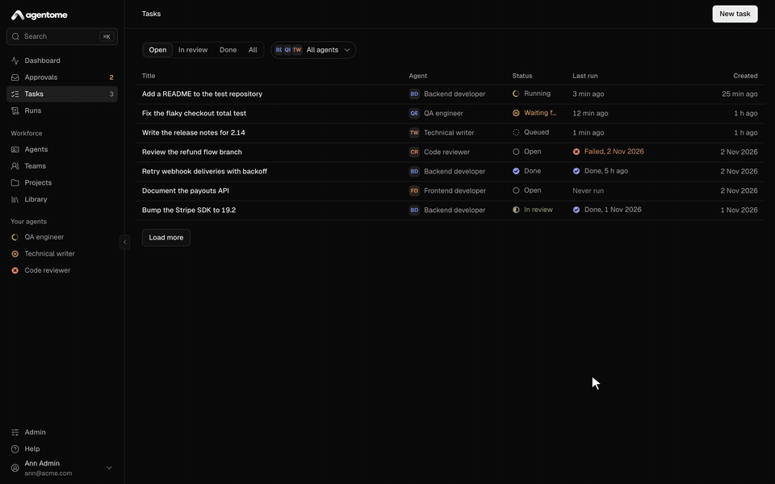
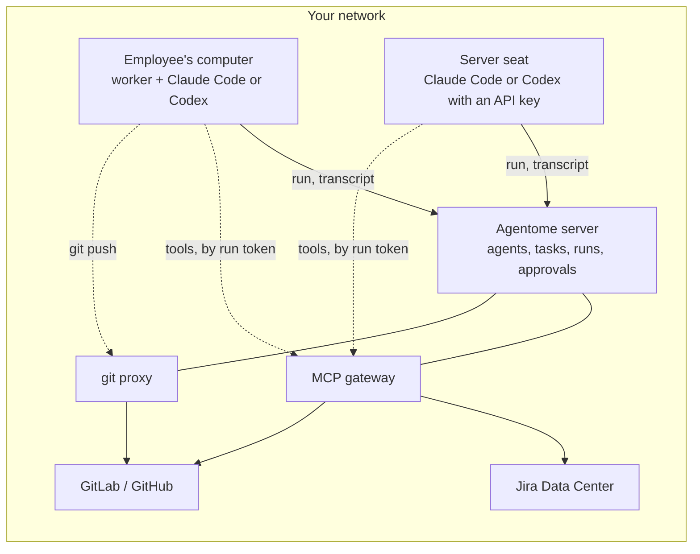
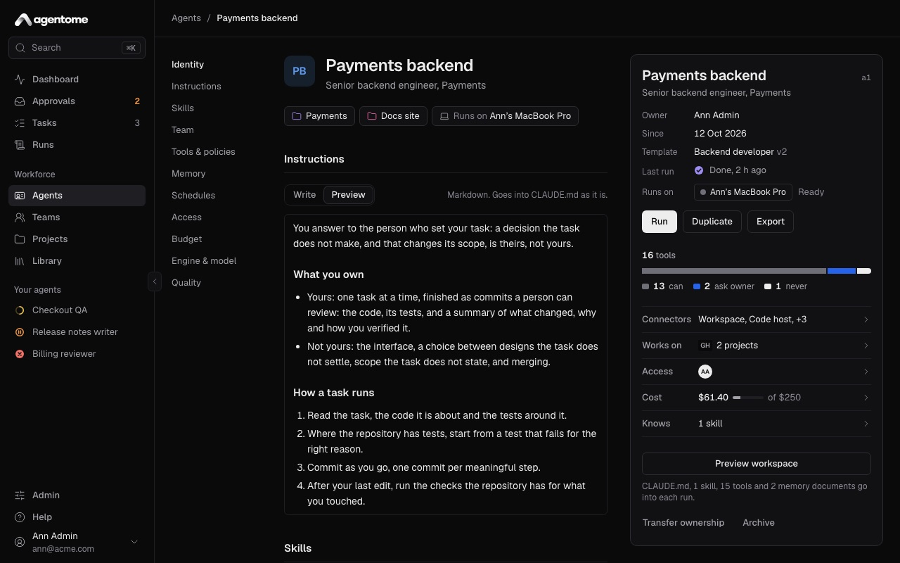
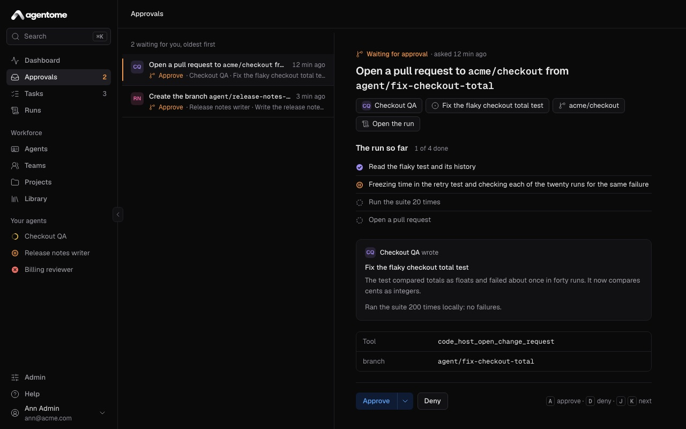
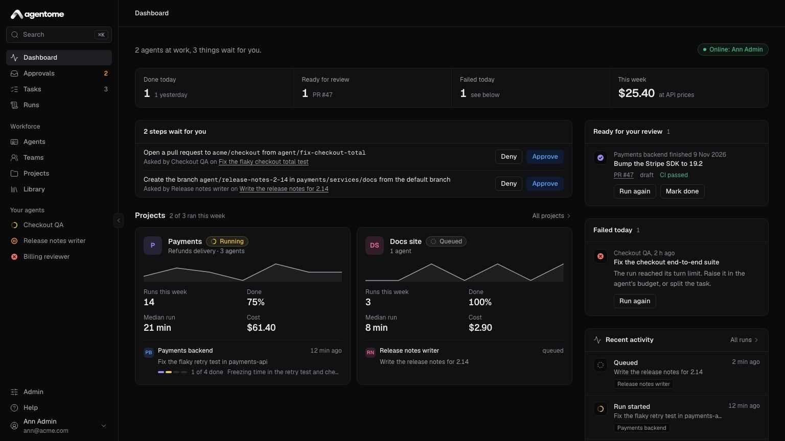

<p align="center">
  <a href="https://agentome.ai">
    <picture>
      <source media="(prefers-color-scheme: dark)" srcset="docs/brand/logo-dark.svg">
      
    </picture>
  </a>
</p>

<h1 align="center">A self-hosted platform for AI employees</h1>

<p align="center">
  Create AI employees for any role: developers, analysts, testers, technical writers, lawyers,<br>
  managers. What each one can do comes from its skills and tools. On your own servers.
</p>

<p align="center">
  <a href="https://github.com/agentome-ai/agentome/releases"></a>
  <a href="https://hub.docker.com/r/agentome/agentome"></a>
  <a href="LICENSE"></a>
</p>

<p align="center">
  <a href="https://agentome.ai">Website</a> ·
  <a href="docs/guide/README.md">Documentation</a> ·
  <a href="#quick-start">Quick start</a> ·
  <a href="deploy/OPERATIONS.md">Install and operate</a> ·
  <a href="https://agentome.ai/agents/">Agent catalog</a> ·
  <a href="#faq">FAQ</a>
</p>

<p align="center">
  <a href="https://agentome.ai"></a>
</p>

## What is Agentome?

**Agentome is a self-hosted platform for AI employees.** You create an agent for any role: a
developer, an analyst, a tester, a technical writer, a lawyer, a manager. What it can do comes from
its skills and its tools: give it the right ones and it does that job. Each agent has an owner,
instructions, memory and the record of everything it did, all kept on your server. People give it
tasks; it works with the company's systems and asks a person before anything you marked as
sensitive.

- **Any role:** skills teach an agent a kind of work, and tools (MCP servers) connect it to the
  systems that work needs. The [agent catalog](https://agentome.ai/agents/) has ready agents for
  engineering, product and design, sales and marketing, customer support, finance and legal, people
  and operations, and data and knowledge.
- **Engines:** Claude Code and OpenAI Codex.
- **Where agents run:** on an employee's computer under their own Claude or ChatGPT subscription,
  while they are at work, or on your server with an API key, directly or through LiteLLM.
- **What they work with:** self-hosted GitLab, GitHub, Jira Data Center, and any MCP server.
- **How you control them:** a policy per tool (allow, ask, deny), approvals on the web and on a
  phone, limits per run, budgets, and the cost and transcript of every run.
- **How you install it:** one Docker Compose file on a machine in your network. The server never
  reports home, and the license key is checked offline.

## Why Agentome

- **Your code and tokens stay in your network.** Agents reach GitLab, GitHub and Jira only through
  the server's MCP gateway, with a token that lives as long as one run. Integration tokens never
  reach a computer, and `git push` goes through the server's git proxy, only to branches under
  `agent/`.
- **Agents belong to the company, not to one person's machine.** An agent's instructions, memory and
  history live on the platform. When its owner goes on holiday or leaves, the agent is handed to
  someone else, with its tasks, and keeps working.
- **Every step can be checked.** A run keeps its plan, its transcript, the calls it made, the change
  requests it opened and what it cost. A call your policy marks "ask" waits for a person.
- **It uses what you already pay for.** On people's computers, agents run on the subscriptions your
  people already have; API keys are needed only for agents that work on the server by themselves.
- **Built for companies that run their own infrastructure:** self-hosted GitLab, Jira Data Center,
  Keycloak, often behind a VPN.

## How it works



1. A task is filed in a project and goes to an agent, or to a team whose lead splits it.
2. A run starts on the computer of the agent's owner while they are at it, or on the server when the
   agent works by itself.
3. The agent works in a clone of the project's repository, with the tools its policy allows, through
   the MCP gateway.
4. A call marked "ask" waits in Approvals. When the run ends, its report, branch and change request
   are on the task, and the agent's memory carries what it learned to the next run.

## Features

<p align="center">
  
</p>

### Agents as employees

- Create an agent from a role template or the [catalog](https://agentome.ai/agents/), or import one
  from a file; export and duplicate it.
- Give it instructions, skills from the shared library, MCP servers, and memory it reads and writes
  between runs, with every version kept.
- Set a policy per tool: allow, ask the owner, or deny.
- Schedule recurring tasks, and hand an agent to another person for good or until a date, with its
  tasks.

### Projects, tasks and runs

- Every task is filed in a project. A project has its agents, its team, its repositories, its Jira
  connection and its knowledge, read from the Markdown docs of its repositories.
- A task works in the project's repository, or in a folder on the computer that runs it.
- A run streams its plan and transcript live, and ends with a report, a branch and a change request.
  Comments on a task go to its next run.

### Teams

- A lead with members: the lead splits a task and gives parts of it to its members, who work at the
  same time inside the lead's run, on the same branch.
- Nested teams: a lead hands work down to the leads of the teams below it. Arrange them by dragging
  on the Teams chart.

<p align="center">
  
</p>

### Approvals and control

- Approvals with the context of the call and the run so far, on the web and as push notifications on
  a phone; questions an agent asks its owner mid-run.
- Limits per run (time, turns, tokens), monthly budgets per agent and per project, and the cost of
  every run.
- An agent's quality over 30 days: what was accepted, what came back, and why.
- Logs and traces for admins; backups and restores from the command line.

### Your systems

- **GitLab** (self-hosted) and **GitHub**: clone and push through the proxy, change requests opened
  by the agent, pipeline and review status back on the task by webhooks.
- **Jira Data Center**: the issues of a project become tasks of its team, and their status follows
  the work.
- **MCP**: any MCP server from the library, including ones that sign in with OAuth.
- **Models**: Anthropic and OpenAI keys, or a gateway such as LiteLLM. **Sign-in**: passwords or
  Keycloak.

### Manage it from Claude Code or Codex

Agentome is also an MCP server for the people who run it. Make a personal token in the web app,
connect it to Claude Code or Codex, and say what you want in your own words: create an agent and
write its instructions, give it skills and tools, set its policies and budget, build a team, file
and run tasks, read runs and their transcripts, approve or deny what waits. Every action is yours,
with your permissions; only what carries secrets (model keys, adding MCP servers, making tokens)
stays in the web app.

```sh
claude mcp add --transport http agentome https://<your server>/mcp/manage --header "Authorization: Bearer <token>"
```

```sh
codex mcp add agentome --url https://<your server>/mcp/manage --bearer-token-env-var AGENTOME_TOKEN
```

Codex reads the token from `AGENTOME_TOKEN` in the environment it starts in.

<p align="center">
  
</p>

## Quick start

On a Linux or macOS machine with Docker Engine 25 or newer and the Compose plugin:

```sh
curl -fsSL https://agentome.ai/install.sh | sh
```

The script puts `compose.yaml` into `./agentome`, pulls the images from Docker Hub
([`agentome/agentome`](https://hub.docker.com/r/agentome/agentome) and `postgres:16-alpine`),
starts them, and prints the address of the first-run setup with its setup code. Open it, create the
administrator, then either connect a computer (Admin → Computers gives a one-time command) or add a
model connection, and give an agent its first task.

The same by hand, without the script:

```sh
mkdir agentome && cd agentome
curl -fsSLO https://raw.githubusercontent.com/agentome-ai/agentome/main/compose.yaml
docker compose up -d
docker compose exec app agentome setup-code   # then open http://localhost:3000/setup
```

Agents on the server, with an API key, run in the
[`agentome/agentome-seat`](https://hub.docker.com/r/agentome/agentome-seat) image; both images are
for amd64 and arm64.

How to set up and use it, with screenshots, is in the [documentation](docs/guide/README.md). HTTPS,
backups, updates and troubleshooting are in [deploy/OPERATIONS.md](deploy/OPERATIONS.md); every
setting and its default is in [deploy/CONFIG.md](deploy/CONFIG.md); how a computer connects is in
[apps/worker/README.md](apps/worker/README.md).

**Updating.** Take a backup, then run the install command again, or set `AGENTOME_VERSION` and
`docker compose pull && docker compose up -d`. Admin shows the version you run and says when a newer
release is out.

## Free and Enterprise

Agentome is free to install and use, in any company, with no time limit. A license key adds what
larger teams need.

|                                               | Free               | Enterprise                     |
| --------------------------------------------- | ------------------ | ------------------------------ |
| Active agents                                 | up to 5            | as many as you need            |
| Teams                                         | one                | any, nested                    |
| Where agents work                             | people's computers | their computers and the server |
| GitLab, GitHub, Jira Data Center, MCP library | yes                | yes                            |
| Approvals, per-run limits, cost of every run  | yes                | yes                            |
| Monthly budgets                               |                    | yes                            |
| Agent quality                                 |                    | yes                            |
| Sign-in with Keycloak                         |                    | yes                            |

For a key, or a 30-day trial key, write to [hello@agentome.ai](mailto:hello@agentome.ai) with the
installation ID from Admin → License. The key is checked offline: Agentome never reports home.

## FAQ

### What is Agentome?

A self-hosted platform for AI employees: agents for any role, from developers and testers to
analysts, lawyers and managers, each defined by its skills and tools. It keeps each agent's role,
instructions, skills, tools and memory on your server, gives it tasks from your projects, runs it
with Claude Code or Codex on a person's computer or on the server, and records and controls
everything it does.

### Is Agentome open source?

Its source is public under the [Elastic License 2.0](LICENSE), a source-available license: you may
read, change and run it in your company for free, but not offer it to others as a hosted service or
work around the license key. It is not an OSI-approved open-source license.

### Does my code leave my network?

The Agentome server, its database, the integration tokens and the git proxy run in your network.
What leaves it is what the agent sends to its model: the prompts and the code it reads go to
Anthropic or OpenAI, or to your own gateway such as LiteLLM, as they would with Claude Code or Codex
used directly. The server itself calls no service of ours.

### Which AI models and agents does it support?

Claude Code (Anthropic's models) and OpenAI Codex. On a person's computer each runs under the
person's own subscription; on the server an agent uses an API key, directly or through LiteLLM, so
any model your gateway serves can be used.

### Do I need an API key?

Not for agents that run on people's computers: they use the subscription of the person at the
computer. An agent that works on the server, without a person, needs an API key in a model
connection.

### Can it run behind a VPN?

Yes. It is built for networks where GitLab, Jira and the model gateway are reachable only inside the
company. The server needs to reach those, and nothing else; Admin's check for a newer release is
made by the admin's browser and can be turned off.

### How is it different from running Claude Code or Codex myself?

The CLI does the work; Agentome makes it a colleague the company owns. The agent's setup and memory
are shared and survive people leaving, tokens stay on the server, risky calls wait for approval,
teams of agents split work, and every run is recorded with its cost.

### What does it cost?

Free covers up to five active agents and one team, with no time limit. Enterprise, with a license
key, removes the limits and adds agents on the server, budgets, quality reports and Keycloak.

## Development

You need Node 22, pnpm (`corepack enable` picks the version from `package.json`) and Docker. Start
PostgreSQL 16 for the dev server:

```sh
docker run -d --name agentome-postgres -p 5432:5432 -e POSTGRES_USER=agentome \
  -e POSTGRES_PASSWORD=agentome -e POSTGRES_DB=agentome postgres:16
```

Then:

```sh
pnpm install
docker compose up -d --build                # the whole thing from this checkout, as agentome:local
pnpm --filter @agentome/server dev          # applies migrations, serves http://localhost:3000
pnpm --filter @agentome/web dev             # the web app on Vite, passing /api on to the server
pnpm typecheck && pnpm lint && pnpm test    # tests start their own PostgreSQL in Docker
pnpm --filter @agentome/db generate --name=<change>   # a migration after editing the schema
pnpm build                                  # the production build into dist/, as in the image
AGENTOME_HTTP_PORT=3100 deploy/smoke.sh     # builds the image and checks a fresh compose install
```

For the web app on Vite, start the server with `AGENTOME_PUBLIC_URL` set to Vite's address
(`AGENTOME_PUBLIC_URL=http://localhost:5173 pnpm --filter @agentome/server dev`): sign-in accepts
requests only from the public address. The server answers `/health`, `/ready` and `/openapi.json`.
The stack is Node 22 and TypeScript, Fastify, Drizzle on PostgreSQL 16, pg-boss, React with Vite and
Tailwind, Vitest and Playwright.

## Contributing and security

Issues are welcome; see [CONTRIBUTING.md](CONTRIBUTING.md). Report a vulnerability privately as
[SECURITY.md](SECURITY.md) says. What changed in each release is in [CHANGELOG.md](CHANGELOG.md).

## License

Agentome is licensed under the [Elastic License 2.0](LICENSE): you may use, change and run it,
including in your company, but not offer it to others as a hosted service, and not move, change,
disable or circumvent the license key or what it unlocks. Parts taken from other projects keep their
licenses; see [THIRD-PARTY-NOTICES.md](THIRD-PARTY-NOTICES.md).
