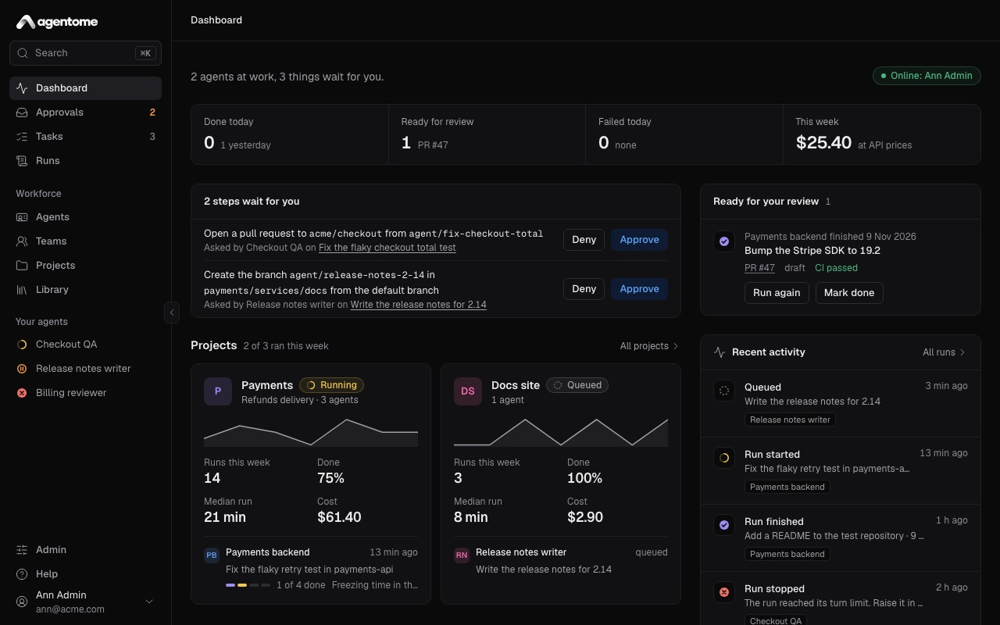

# Agentome documentation

Agentome is a self-hosted platform for AI employees. You create agents for any role: developers,
analysts, testers, technical writers, lawyers, managers. What each one can do comes from its skills
and tools. This guide shows how to install it, set it up and use it every day. It is written for the
people who use agents and for the admins who run the installation.

## Start here

- [Getting started](getting-started.md): install Agentome, create the administrator, connect a
  computer or a model, and see an agent finish its first task.
- [Concepts](concepts.md): agents, projects, tasks, runs, teams, policies and approvals, and how
  they fit together.

## Use it every day

- [Agents](agents.md): create an agent, write its instructions, give it skills and tools, decide
  what it may do on its own, look after its memory and schedule its work.
- [Projects and tasks](projects-and-tasks.md): projects with their repositories and knowledge,
  filing a task, following a run, and reviewing what it did.
- [Teams](teams.md): a lead with members, the order they work in, and teams below teams.
- [Approvals and control](approvals-and-control.md): tool policies, approvals, questions from
  agents, notifications on your phone, limits, budgets and cost.

## Set it up

- [Where agents run](computers.md): a person's computer under their own subscription, or the server
  with an API key; connecting a computer and keeping its worker up to date.
- [Integrations](integrations.md): GitLab, GitHub, Jira Data Center, MCP servers, model connections
  and Keycloak.
- [Administration](administration.md): people, the license, the version and updates, backups, logs,
  API tokens, and managing Agentome from Claude Code or Codex.

## For operators

- [Operations](../../deploy/OPERATIONS.md): installing, HTTPS, updating, rolling back, backups,
  agents on the server, troubleshooting.
- [Configuration](../../deploy/CONFIG.md): every setting and its default.

Something missing or wrong? [Open an issue](https://github.com/agentome-ai/agentome/issues).
