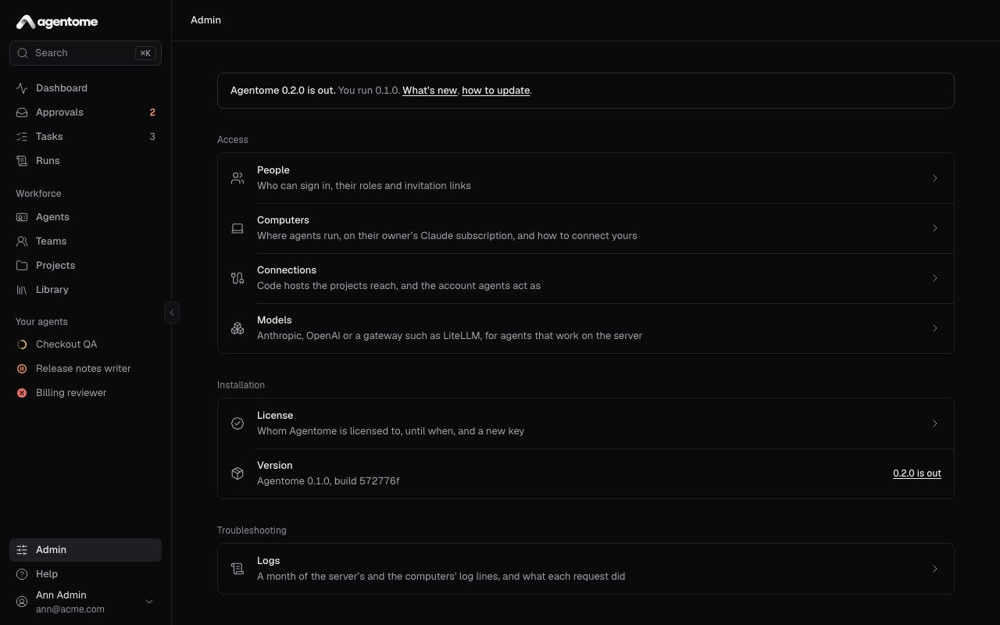
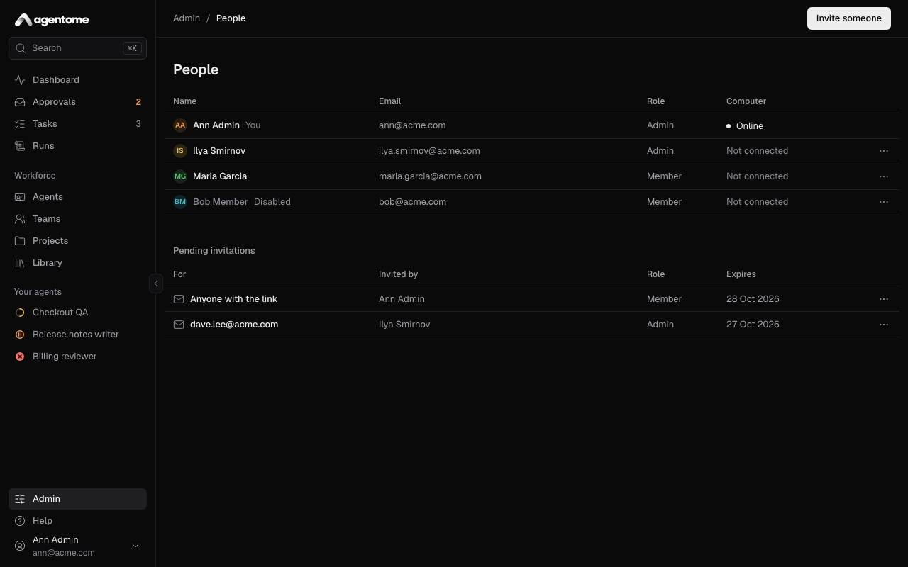
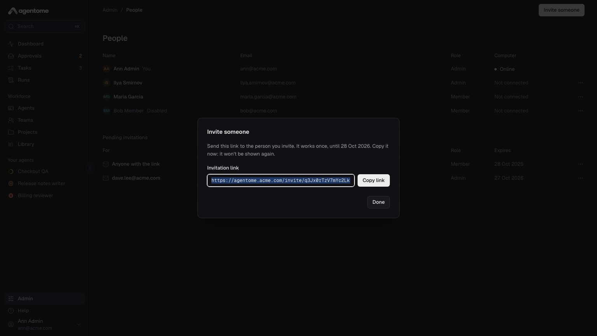
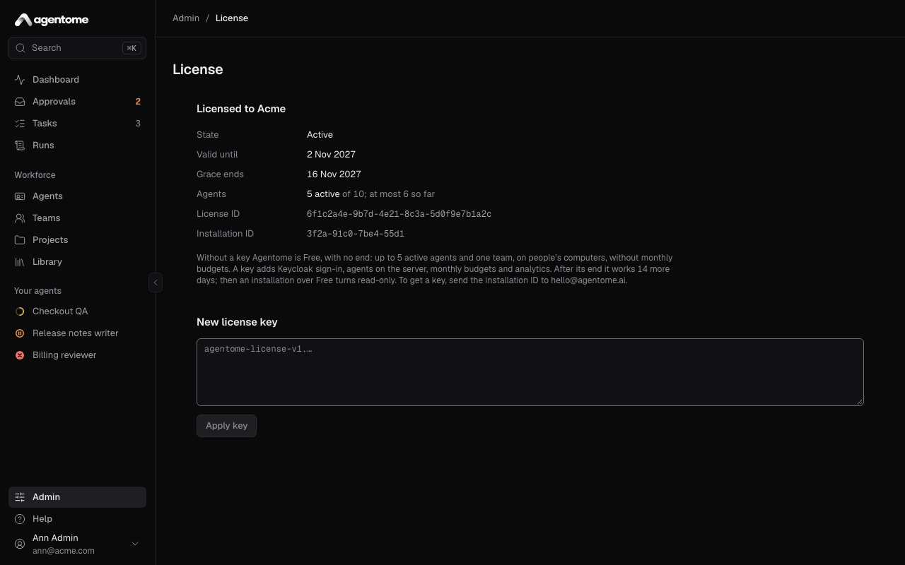
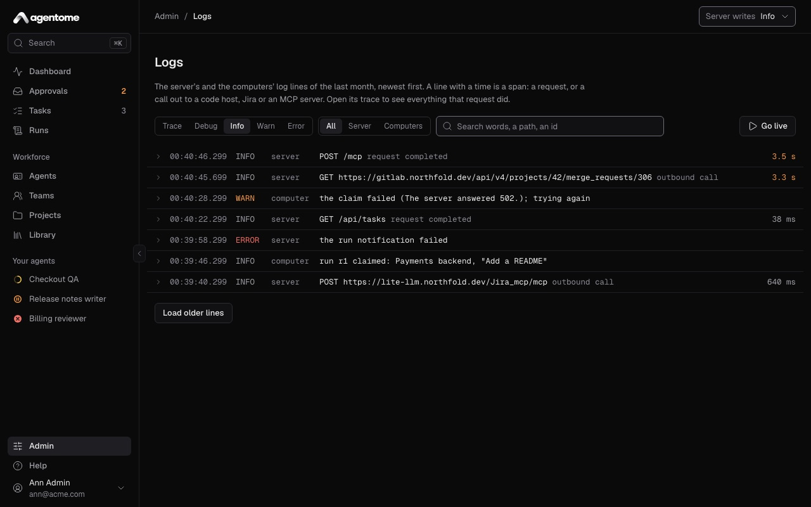
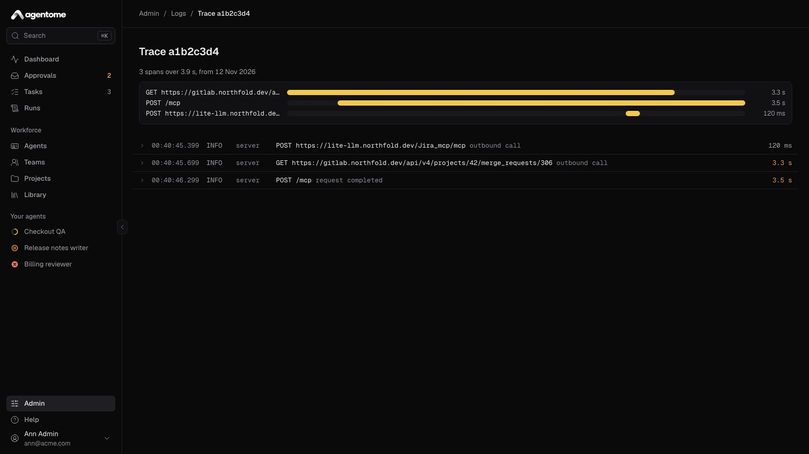
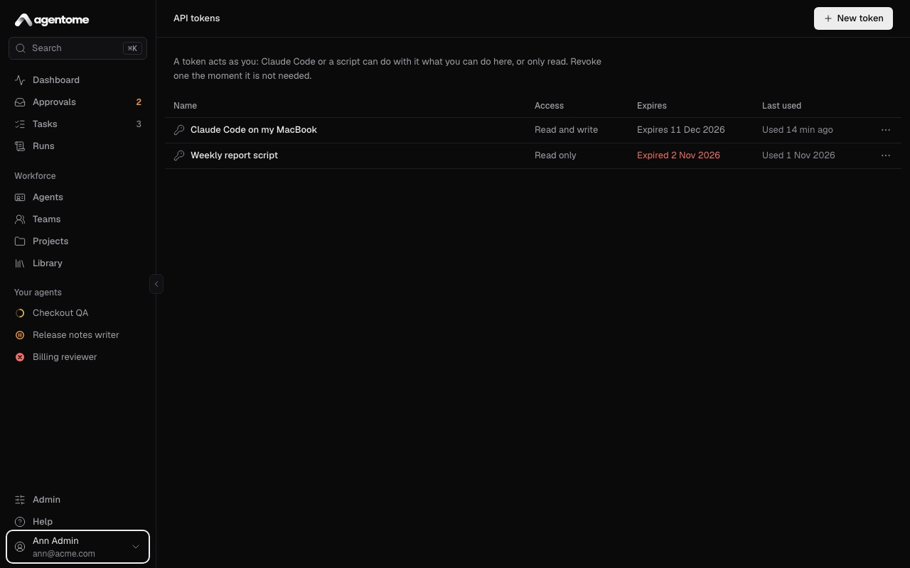

# Administration

This page is for the admins of an Agentome installation: the people who invite colleagues, connect
systems, add the license key, keep the server up to date and find out what went wrong. Most of it
happens on the **Admin** page; the rest is a command on the server.

- [The Admin page](#the-admin-page)
- [People](#people)
- [License](#license)
- [Version and updates](#version-and-updates)
- [Backups and restore](#backups-and-restore)
- [A forgotten password](#a-forgotten-password)
- [HTTPS](#https)
- [Logs and traces](#logs-and-traces)
- [API tokens and managing Agentome from Claude Code or Codex](#api-tokens-and-managing-agentome-from-claude-code-or-codex)

## The Admin page

Open **Admin** in the sidebar. Its pages are in three groups.



| Group           | Page            | What it is for                                                           |
| --------------- | --------------- | ------------------------------------------------------------------------ |
| Access          | **People**      | Who can sign in, their roles and invitation links                        |
| Access          | **Computers**   | The computers agents run on, and how to connect one                      |
| Access          | **Connections** | GitLab, GitHub and Jira for each project, and the account agents act as  |
| Access          | **Models**      | Anthropic, OpenAI or a gateway such as LiteLLM, for agents on the server |
| Installation    | **License**     | Free or Enterprise, the installation ID, and a new key                   |
| Installation    | **Version**     | The version the server runs, and whether a newer one is out              |
| Troubleshooting | **Logs**        | A month of the server's and the computers' log lines, and traces         |

Computers are covered in [Computers](computers.md); connections and models in
[Integrations](integrations.md).

## People

Admin → People lists everyone who can sign in, with their email, role and computer, and the
invitations that are not used yet.



There are two roles:

- **Member**: works with agents, tasks and projects.
- **Admin**: also manages people and settings in Admin.

### Invite someone

Agentome sends no mail. You create a link and pass it on yourself.

1. Select **Invite someone**.
2. Pick the **Role**: **Member** or **Admin**.
3. Select **Create link**.
4. Select **Copy link** and send the link to the person, by a channel only they read.



The link works once and expires in 7 days. It is shown only once. The person opens it, gives their
name, email and a password of at least 12 characters, and is in. Until then the invitation is under
**Pending invitations**, where its menu has **Revoke**: the link stops working at once.

With Keycloak sign-in, people do not need an invitation: their first sign-in makes them a member
(see [Sign-in with Keycloak](integrations.md#sign-in-with-keycloak)).

### Disable a person

Open the person's menu and select **Disable**. Then:

- they are signed out everywhere and cannot sign in;
- a run going on their computer stops, and their computers take no more runs;
- invitations they created and nobody used stop working.

Their agents are not touched: transfer them to someone else (below). Select **Enable** in the same
menu to let the person back in. You cannot disable yourself, so the installation always keeps an
admin who can sign in.

### Transfer a leaving person's agents

When someone leaves, their agents stay with the company.

1. Open the person's menu in Admin → People and select **Transfer agents**.
2. Pick the **New owner**.
3. Select **Transfer**.

Every agent the person owns goes to the new owner for good, with its memory, history and teams. Its
runs then go to the new owner's computer, and its approvals to them. An agent the person had only
for a time goes back to its owner. Sign-ins to MCP servers are personal: the new owner signs in
again to the ones the agents use.

To hand one agent over, for good or until a date, use the agent's own page; see [Agents](agents.md).

## License

Agentome is free to install and use with no time limit. A license key makes it Enterprise.

|                       | Free               | Enterprise                     |
| --------------------- | ------------------ | ------------------------------ |
| Active agents         | up to 5            | as many as you need            |
| Teams                 | one                | any, nested                    |
| Where agents work     | people's computers | their computers and the server |
| Monthly budgets       |                    | yes                            |
| Agent quality         |                    | yes                            |
| Sign-in with Keycloak |                    | yes                            |

Everything else, such as GitLab, GitHub, Jira, the MCP library, approvals, run limits and the cost
of every run, is in both.



Admin → License shows:

- **State**: **Free**, **Active**, in its grace, or read-only;
- **Valid until** and, after the end, **Grace ends**;
- **Agents**: how many are active, against the plan;
- **Installation ID**: the ID a key can be made out to.

### Add a key

1. Copy the **Installation ID** and send it to hello@agentome.ai to get a key, or a 30-day trial
   key.
2. Paste the key in **New license key**.
3. Select **Apply key**.

The key works at once, without a restart. It is checked on the server, offline: Agentome never
reports home.

If you have more active agents than the key's plan, nothing stops: the page says by how many, and
the next license counts them.

### When a key ends

After a key's last day, Agentome works 14 more days, with a line at the top of every page that says
so. Then:

- an installation within Free goes on as Free;
- an installation over Free turns read-only: everyone can sign in and look at everything, but
  nothing runs or changes. Runs already going finish.

Over Free means more than five active agents, more than one team, agents on the server, or monthly
budgets. Admin → License lists which. To get out of read-only, apply a new key, or cut back to Free:
archive agents, remove teams, move agents to their owners' computers, take monthly budgets off.
Agentome works again at once.

See also [License](../../deploy/OPERATIONS.md#license) in the operator docs.

## Version and updates

Admin → Installation shows **Version**, the version the server runs and its build, such as "Agentome
0.2.0, build 572776f". Name it when you ask for help.

When a newer release is out, the row says so, and a line at the top of Admin links to what is new
and to how to update. Otherwise the row says **Up to date**.

The check is made by your browser, which asks GitHub for the latest release at most once a day; the
server itself asks nobody. To turn the check off, for an installation whose people must not reach
outside, set `AGENTOME_UPDATE_CHECK=false` (see [Version](../../deploy/CONFIG.md#version)).

To update:

1. Take a backup (see below).
2. Set `AGENTOME_VERSION` to the new version in `.env`, or run the install script again.
3. Run `docker compose pull && docker compose up -d`.

The server applies its database migrations on start, and your data stays in its volumes. After an
update, Admin → Computers says which computers have an out-of-date worker, with the command to
update it. Details, and how to roll back, are in [Updating](../../deploy/OPERATIONS.md#updating) and
[Rolling back](../../deploy/OPERATIONS.md#rolling-back).

## Backups and restore

A backup is one `.tar.gz` with the database and the data directory, which holds the server's secret
key. Keep it as carefully as the server itself.

Take one, while the server runs:

```sh
(umask 077; docker compose exec -T app agentome backup > agentome-$(date +%F).tar.gz)
```

Restore one, with the server stopped:

```sh
docker compose stop app
docker compose run --rm -T app agentome restore < agentome-2026-10-21.tar.gz
docker compose up -d
```

Restore with the version that made the backup, or a newer one. The same commands move an
installation to another machine. Scheduling backups and what can go wrong are in
[Backing up and restoring](../../deploy/OPERATIONS.md#backing-up-and-restoring).

## A forgotten password

Agentome sends no mail, so the sign-in page has no "forgot password". Whoever runs the server makes
a link for the person:

```sh
docker compose exec app agentome reset-password ann@acme.com
```

Pass the link to the person as you would a password. It works once, for an hour, and sets a new
password. The new password signs the person out everywhere and revokes their API tokens; their
computers stay connected.

This is also the way back in for the only admin. It does not let a disabled person in, and it does
not apply to an account that signs in only through Keycloak. See
[A forgotten password](../../deploy/OPERATIONS.md#a-forgotten-password).

## HTTPS

Give Agentome an HTTPS address before you connect computers or turn on notifications:

- a computer downloads its worker from the server, which over plain HTTP anyone on the way could
  replace;
- phones and browsers deliver notifications only over HTTPS.

The installation's `proxy` profile adds Caddy, which serves HTTPS in one of two ways:

- **With a domain**: a certificate from Let's Encrypt, renewed by itself. See
  [HTTPS with the proxy profile](../../deploy/OPERATIONS.md#https-with-the-proxy-profile).
- **On a local network without a domain**: a certificate for the machine's IP address from Caddy's
  own authority, which each phone and computer trusts once. See
  [HTTPS on a local network](../../deploy/OPERATIONS.md#https-on-a-local-network).

If GitLab, Jira or an MCP server inside the company carries a certificate of the company's own
authority, give the server that root certificate; see
[A company certificate authority](../../deploy/OPERATIONS.md#a-company-certificate-authority).

## Logs and traces

Admin → Logs shows the log lines of the server and of the connected computers from the last month,
newest first.



To find what you need:

- Pick the lowest level to show: trace, debug, info, warn or error.
- Pick the source: **All**, **Server** or **Computers**.
- Search for words, a path or an ID.
- Select **Go live** to follow new lines as they come.

Select a line to see its details. A line with a duration is a span: a request to the server, or a
call out to a code host, Jira or an MCP server. From a line you can open:

- **Trace** and its ID: everything that one request did, drawn as a waterfall;
- **Run** and its ID: the run it belongs to;
- **Every line of this run**: the log filtered to that run.



A run's page has a **Logs** link that opens the same filter.

**Server writes**, at the top right, sets how much the server logs, from **trace** (everything, for
a short look) to **error** (failures only). **info** is the usual. Lines are kept for 30 days;
`AGENTOME_LOG_RETENTION_DAYS` changes that (see
[Server settings](../../deploy/CONFIG.md#server-settings)).

When the web app itself does not open, look at the server's own log with
`docker compose logs -f app`; see [Troubleshooting](../../deploy/OPERATIONS.md#troubleshooting).

## API tokens and managing Agentome from Claude Code or Codex

A personal API token acts as you. With it, Claude Code, Codex or a script can do what you can do in
the web app, or only read. Every person makes their own tokens; admins and members alike.



### Make a token

1. Open **API tokens**: on a computer, from the menu under your name at the bottom of the sidebar;
   on a phone, from **More**.
2. Select **New token** and give it a name.
3. Pick when it **Expires**: 7, 30 or 90 days, 1 year, a custom number of days, or **No expiry**.
4. Pick the **Access**:
   - **Read and write**: everything you can do here.
   - **Read only**: sees everything, changes nothing.
5. Select **Create token**.
6. Copy the token at once: it is shown only once.

Tokens are made and revoked only in the browser, so a token that leaks cannot make more of itself.
Revoke one with **Revoke** in its menu the moment it is not needed. Setting a new password with a
reset link revokes all of a person's tokens.

### Connect Claude Code

The dialog that shows the new token also gives the command to connect Claude Code. Run it once:

```sh
claude mcp add --transport http agentome https://<server>/mcp/manage --header "Authorization: Bearer <token>"
```

The command keeps the token in your shell history and in Claude Code's own configuration. If either
leaks, revoke the token.

### Connect Codex

Codex reads the token from an environment variable, so it stays out of Codex's configuration. Add
the server once:

```sh
codex mcp add agentome --url https://<server>/mcp/manage --bearer-token-env-var AGENTOME_TOKEN
```

Then start Codex where `AGENTOME_TOKEN` holds the token, for example after
`export AGENTOME_TOKEN=<token>` in your shell profile. `codex mcp list` shows the server.

### What it can do

Claude Code or Codex can then manage Agentome for you, in your words: list and create agents, change
their instructions, tool policies and budgets, hand agents over, create and run tasks, read runs and
their transcripts, approve, deny and answer requests, manage skills, teams and project knowledge,
read logs and the license. Every action is yours, with your permissions.

With a **Read only** token, they get only the tools that read.

Some things stay in the web app on purpose, because they carry secrets: adding or changing an MCP
server, adding a model connection's key, and making tokens.
