# Agents

This page covers everything you do with an agent: create it, write its instructions, give it skills
and tools, decide what it may do on its own, look after its memory, schedule its work, choose where
it runs, hand it to someone else and keep its cost in check.

An agent can do any job: develop, test, analyse, write documentation, review contracts, manage a
backlog. Its role comes from its instructions, its skills and its tools.

- [Your agents](#your-agents)
- [Create an agent](#create-an-agent)
- [Duplicate and export](#duplicate-and-export)
- [The agent editor](#the-agent-editor)
- [Instructions](#instructions)
- [Skills](#skills)
- [Team](#team)
- [Tools and policies](#tools-and-policies)
- [Memory](#memory)
- [Schedules](#schedules)
- [Access, transfer and archive](#access-transfer-and-archive)
- [Budget](#budget)
- [Engine and model](#engine-and-model)
- [Quality](#quality)

New to Agentome? Read [Concepts](concepts.md) first: it explains agents, projects, tasks and runs.

## Your agents

Open **Agents** in the sidebar. The list shows the agents you own, with their **Role title**,
**Owner**, **Accepted** and **Cost per task** over the last 30 days, and their **Last run**. While
an agent is at work, **Last run** names its task; click it to open the run. Click a row to open the
agent in the editor. The **Archived** tab, next to **Active**, lists archived agents.

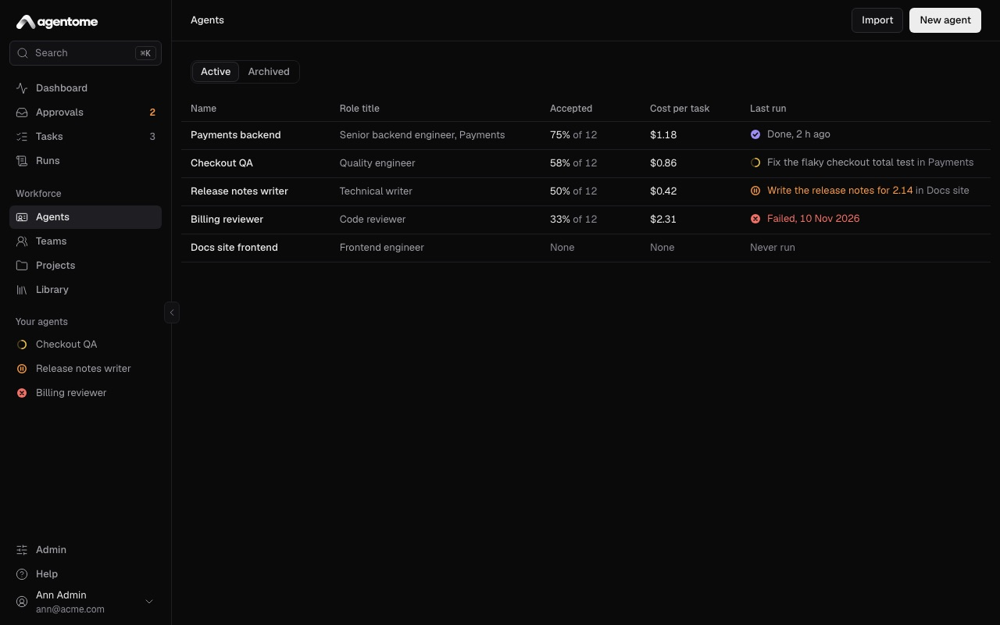

## Create an agent

You can start an agent from a role template, from a blank agent, or from a file. On Free, an
installation can have up to five active agents; more need a license key.

### From a role template

1. Open **Agents** and click **New agent**.
2. In the list, pick a role template, such as **Backend developer**, **Frontend developer**, **QA
   engineer**, **Code reviewer**, **Technical writer**, **Release manager** or **Product owner**.
   Pick **Blank agent** to start empty and write the instructions yourself.
3. Check **Name** and **Role title**. A template fills both in; whatever you type stays when you
   pick another template.
4. Click **Create agent**. The new agent opens in the editor.

A template is a starting point. It fills in the instructions, a preferred model and per-run limits;
after that, the agent is yours to change, and a later change to the template does not change your
agent. The agent sheet shows which template an agent came from under **Template**.

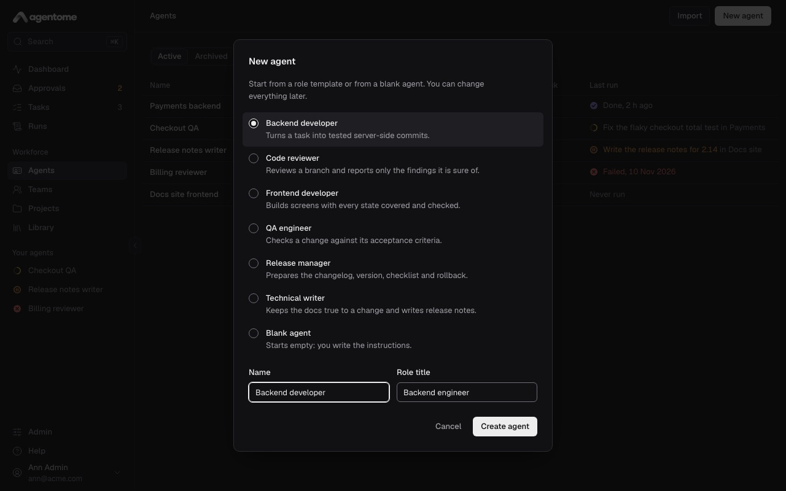

### From a file (Import)

An agent file is an `.agent.json` file: one exported from Agentome, or one from the agent catalog at
[agentome.ai/agents](https://agentome.ai/agents/).

1. Open **Agents** and click **Import**.
2. Click **Choose a file** and pick the `.agent.json` file.
3. Check what the file brings: the agent's name and role, its **Skills**, its **MCP servers** and,
   for a catalog agent, where it comes from and under which license. If it is the wrong file, click
   **Choose another file**.
4. Click **Import agent**.

The agent's skills join your library as your own skills. Where your library already has the same
text, that skill is used as it is. The agent gets the MCP servers of your library that have the same
names. If the file names servers your library does not have, the dialog lists them before the agent
opens: add them in **Library** (see [Integrations](integrations.md)), then give them to the agent in
its **Tools & policies** section.

An older agent file brings only the agent itself, and the dialog says so.

## Duplicate and export

Both buttons are on the agent sheet, the panel on the right of the editor.

- **Duplicate** makes a new agent of yours named after the original with "(copy)" at the end. It
  copies the role title, instructions, engine, model, skills, tools with their policies and the
  budget. Memory, schedules, projects, teams and runs stay with the original. The copy opens in the
  editor.
- **Export** downloads the agent as an `.agent.json` file: its name, role, instructions, engine,
  model, budget, tool policies, skills (as their full `SKILL.md`), and the names of its MCP servers.
  The file holds no owner, no memory, no history and no secrets. Import it on another Agentome, or
  keep it as a backup of the setup.

## The agent editor

The editor is one page. On a wide screen it has three columns:

- On the left, the list of sections. Click one to jump to it. A section with unsaved edits has a bar
  beside its name.
- In the middle, the sections themselves: **Identity**, **Instructions**, **Skills**, **Team**,
  **Tools & policies**, **Memory**, **Schedules**, **Access**, **Budget**, **Engine & model** and
  **Quality**.
- On the right, the agent sheet: the agent as it stands, updated as you type.

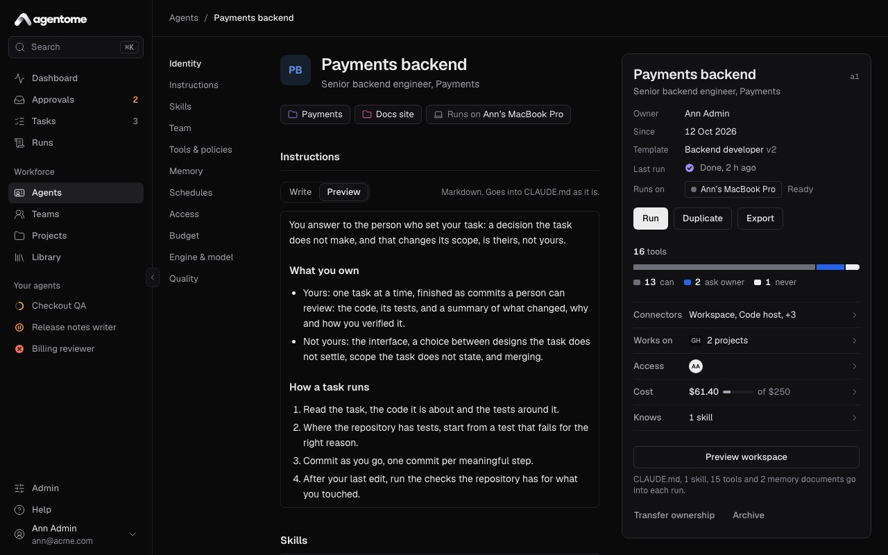

### Identity

The top of the page is the agent's name and role title. Click either to edit it. Under them are the
projects the agent is on; an agent on no project reaches no repository. You add an agent to a
project from the project's page; see [Projects and tasks](projects-and-tasks.md). When its owner has
a computer connected, a chip says **Runs on** and names it.

### The agent sheet

The sheet sums up the agent:

- **Owner**, **Since**, **Template** and **Last run**.
- **Runs on**: the computer or server seat that runs it, and whether it is ready, busy or offline.
  **No computer connected** means the owner has not connected a computer yet; see
  [Where agents run](computers.md).
- **Works on**: its projects and their repositories.
- **Run**, **Duplicate** and **Export**. **Run** opens a new task for this agent; a run is always a
  run of a task.
- Its tools, as a bar split by policy, and **Connectors**: click to see each tool with **Can**,
  **Ask owner** or **Never**.
- **Access**, **Cost** (this month, against the monthly limit if one is set) and **Knows** (its
  skills, with the private ones marked).
- **Preview workspace**, and under it a line that says what goes into each run.
- **Transfer ownership** and **Archive**.

### Preview workspace

Click **Preview workspace** on the sheet to see exactly what a run of the agent gets. The dialog has
two tabs:

- **CLAUDE.md**: the file the engine reads first. It holds the agent's name and role, its
  instructions, the rules of the workspace, the list of its skills with what each is for, and, for a
  team lead, its team.
- **Settings**: the settings the engine runs with, such as the tools it may use without asking and
  its sandbox.

Click **Copy** to copy the file you are looking at, and **Done** to close.

Next to `CLAUDE.md`, a run also gets each skill's `SKILL.md`, the agent's memory documents as they
were when the run started, and, for a task in a project, a `PROJECT.md` about the project. The
preview shows the saved agent: if you have unsaved changes, it says so, and you see them only after
you save.

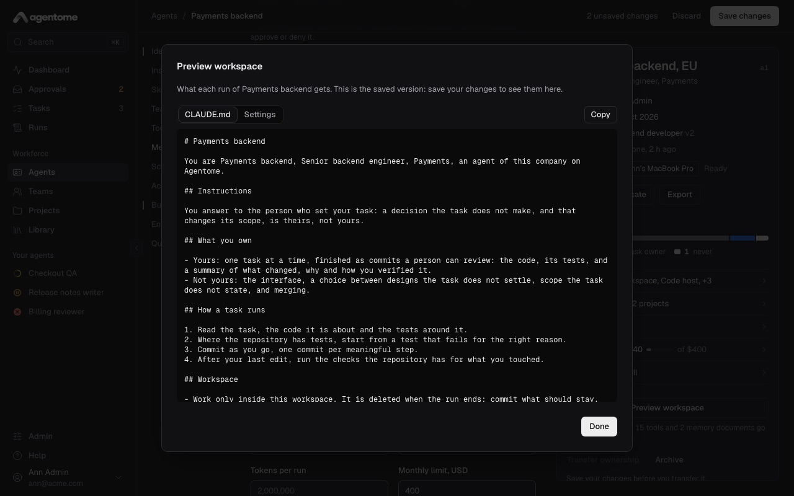

### Saving

The sections save in two ways.

- **Identity**, **Instructions**, **Budget** and **Engine & model** are a draft. The page header
  counts your edits, for example **2 unsaved changes**. Click **Save changes**, or press ⌘S (Ctrl S
  on Windows and Linux) from any field. Click **Discard** to drop the edits.
- **Skills**, MCP servers, policies, **Memory**, **Schedules** and **Team** save the moment you
  change them, and apply to the agent's next run.

If you try to leave the page with unsaved edits, Agentome asks **Leave without saving?**. Click
**Keep editing** to stay, or **Leave without saving** to drop them. The browser also asks before you
close or reload the tab.

## Instructions

The instructions are the agent's job description: what it does, how it works, and when a task is
done. Write them in Markdown. They go into the agent's `CLAUDE.md` as they are, under an
**Instructions** heading.

Edit them on the **Write** tab and read them formatted on **Preview**. An agent with instructions
opens on **Preview**, an empty one on **Write**.

Good instructions say what the agent owns and what it does not, the steps of a typical task, what it
checks before it says it is done, and what it must never do. The role templates are a good model to
start from.

## Skills

A skill is a `SKILL.md` file that tells an agent how to do one kind of work, such as writing release
notes or reviewing a migration. Skills live in the **Library**, and an agent reads one when a task
calls for it.

To give the agent a skill, click **Add a skill** in the **Skills** section, search for the skill and
pick it; the list shows each skill with its version. To take a skill away, click the cross on its
chip.

### Shared and private skills

In **Library**, skills come in three groups: **Yours**, **Shared by others** and **From Agentome**.
A skill you add is private: only you can give it to your agents until an admin opens it and chooses
**Share with everyone**. A private skill shows **private** on its chip in the editor, and the sheet
counts private skills under **Knows**.

To add a skill to the library, open **Library**, click **Add a skill**, paste the `SKILL.md`, and
click **Add skill**. Its frontmatter names the skill and says what it is for.

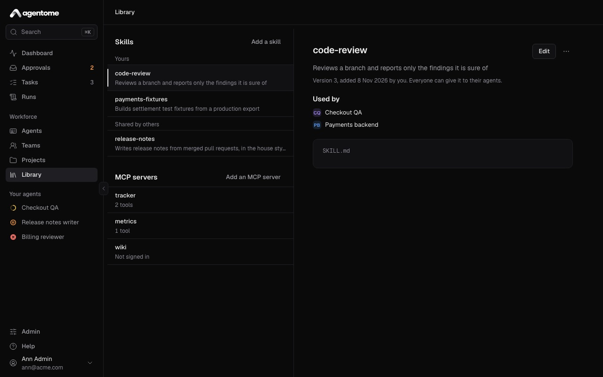

### Versions

Each skill has versions. To change one of your skills, open it in **Library**, click **Edit**, and
click **Save as a new version**. Keep the name to save a new version; a new name makes a new skill.

An agent keeps the version it was given; only a skill **From Agentome** is updated in place when
Agentome is. When the library has a newer version, the editor shows **Move to version** with its
number next to the skill's chip. Click it when you are ready for the agent to use the new text. The
skill's page in the library lists which of your agents have it, under **Used by**.

## Team

The **Team** section says which team the agent leads and which teams it is a member of, each as a
link to the team's page. If the agent leads no team, you can click **Create a team it leads**. You
add members on the team's page. An agent on the Codex engine cannot lead a team. Teams, nested teams
and how a lead splits a task are in [Teams](teams.md).

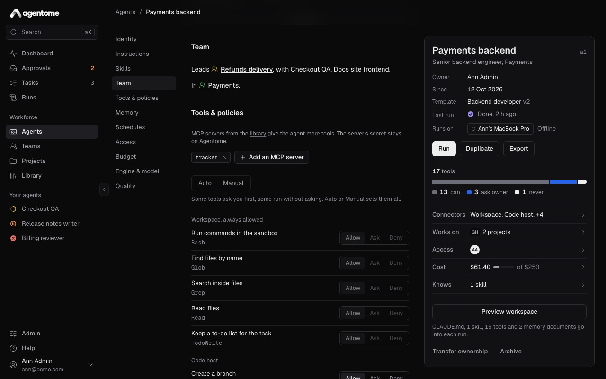

## Tools and policies

The **Tools & policies** section decides what the agent can reach and what it may do without asking.

### MCP servers from the library

At the top of the section, click **Add an MCP server** and pick one of the servers in your library.
Its tools join the list below under the server's name. To take a server away, click the cross on its
chip. The server's secret stays on Agentome and never reaches the computer that runs the agent. You
add servers to the library in **Library** with **Add an MCP server**; see
[Integrations](integrations.md).

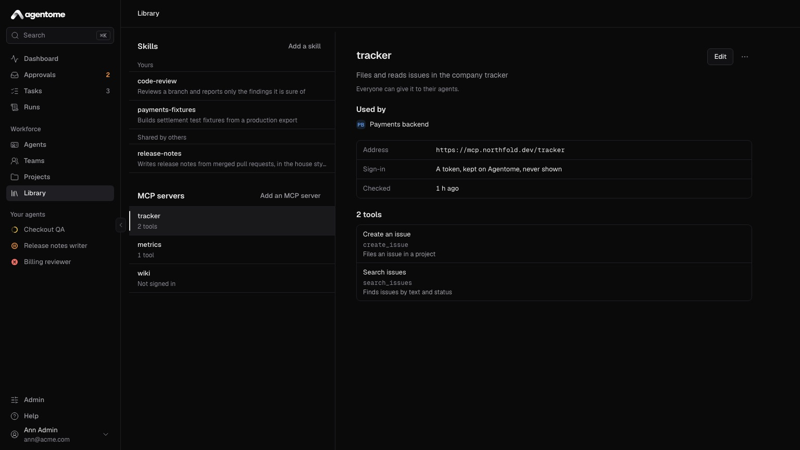

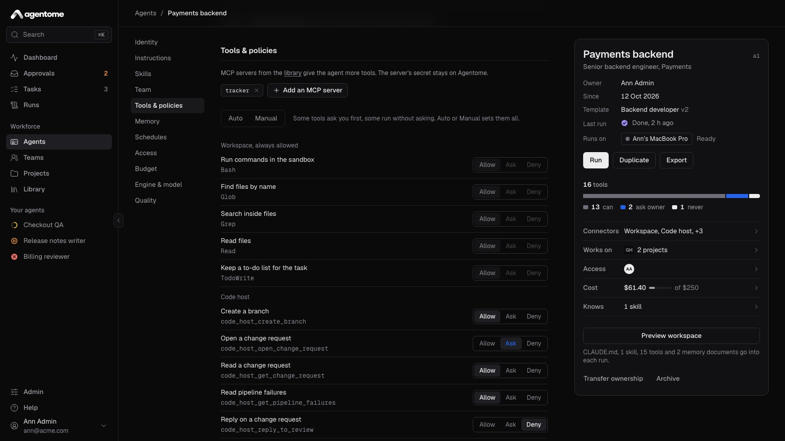

### Policies

Each tool has one of three policies. Click one next to the tool to change it; it saves at once and
applies to the next call.

- **Allow**: the agent uses the tool without asking.
- **Ask**: the call waits for the owner. The sheet calls this **Ask owner**.
- **Deny**: the call is refused, and the agent is told so.

The tools come in groups: the code host (create a branch, open a change request, read a change
request and its pipeline failures, reply on it), the agent's task, its memory, the projects'
knowledge, Jira, and each MCP server. The **Workspace** group is always allowed: those are the
engine's own tools, such as reading and editing files in the run's workspace, which it uses with
nobody to ask.

Until you change them, opening a change request and commenting on a Jira issue ask first, every tool
of an MCP server asks first, a team lead's **Start a team step** asks first, and the rest are
allowed.

The **Auto** and **Manual** switch above the list sets every tool at once: **Auto** allows them all,
**Manual** makes them all ask. A tool you denied stays denied either way.

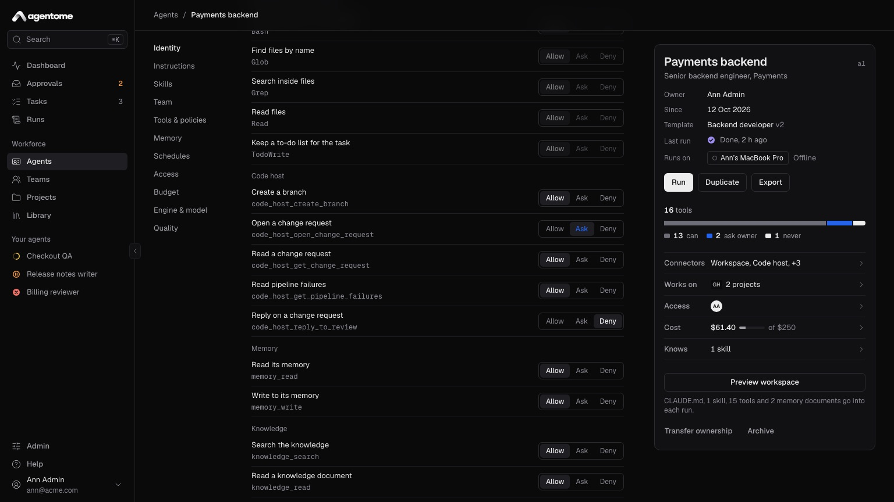

### What Ask does

When the agent calls a tool set to **Ask**, the call stops and waits in **Approvals**. The run shows
as waiting for approval. The owner sees what the agent wants to do and the run so far, and clicks
**Approve** or **Deny**; the run goes on with that answer. The time a run waits for a person does
not count against its time limit.

Approvals on the web and on a phone are in [Approvals and control](approvals-and-control.md).

## Memory

An agent's memory is a set of Markdown documents that carry what it learned from one run to the
next. There is `MEMORY.md`, and any number of documents in `memory/`, such as `memory/stripe.md`.
Each run gets them beside its `CLAUDE.md`, as they were when the run started, and the agent saves a
document again with its memory tool when it learns something worth keeping. The **Memory** section
lists the documents with their current version and when they changed.

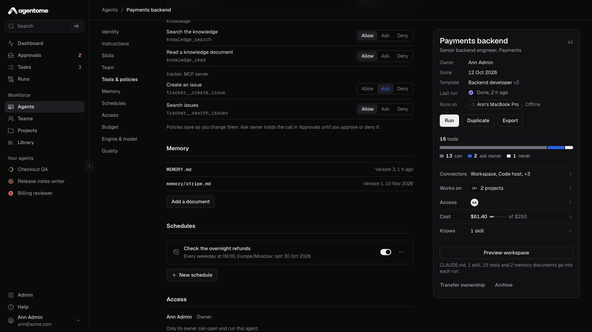

### Read and edit a document

1. Click a document. It opens on **Document**, formatted.
2. Click **Edit**, change the text, and click **Save**.

Every save makes a new version; the old one stays. If the agent or someone else changed the document
after you opened it, Agentome refuses the save and says so. Your text stays in the field so you can
copy it; close the document, open it again, and make your change on the new version.

### Add a document

1. Click **Add a document**.
2. In **Path**, type `MEMORY.md` or a name in `memory/`, such as `memory/release-steps.md`.
3. Write the text and click **Save**.

The agent reads it in every run, beside its instructions. Use this to give the agent a note it
should keep in mind.

### Versions and reverting

Open a document and click **History**. On the left are its versions; click one to see what changed
from the version before it, line by line, and who wrote it: **by a run**, with a link to that run,
or by a person's name.

To go back, pick an earlier version and click **Revert to version** with its number. Reverting saves
that text as a new version, so nothing is lost and you can revert the revert.

## Schedules

A schedule gives the agent the same task on set days at a set time, as if someone filed it.

### Add a schedule

1. In the **Schedules** section, click **New schedule**.
2. Pick the **Project** its tasks are filed in. Every task belongs to a project, so the agent must
   be on at least one; if it is on none, the dialog says so and links to **Projects**.
3. In **Task**, name the task, for example "Write the weekly release notes".
4. In **What to do**, describe the work in Markdown. It goes to the agent as it is.
5. Under **Days**, click the days it runs. Monday to Friday are on to start with.
6. Pick a **Time**, in half hours, and a **Time zone**. The time zone starts as your browser's.
7. Click **Add schedule**.

The list shows each schedule with when it runs, its time zone and when it last ran. Use the switch
on a row to pause or resume it. To delete one, open its **Actions** menu and click **Remove**.

A scheduled task runs where the agent works (see [Engine and model](#engine-and-model)). On the
owner's computer, the run waits until the owner is at the computer; on the server, it starts at
once. If the agent has reached its monthly limit, the task is still made and waits for its owner. A
minute missed while the Agentome server was down is skipped, not caught up.

## Access, transfer and archive

### Access

The **Access** section lists who holds the agent: its owner, and, while it is lent, who has it until
which day. Only its owner can open and run an agent. To let someone else work with an agent,
transfer it to them.

### Transfer ownership

Transfer an agent when its owner goes on holiday, changes role or leaves. The agent's memory,
history and settings go with it.

1. Save any unsaved changes first; **Transfer ownership** stays unavailable until you do.
2. On the agent sheet, click **Transfer ownership**.
3. In **New owner**, choose a person.
4. In **Comes back**, leave **Never: it is theirs for good**, or pick the day it returns to you.
5. Click **Transfer**.

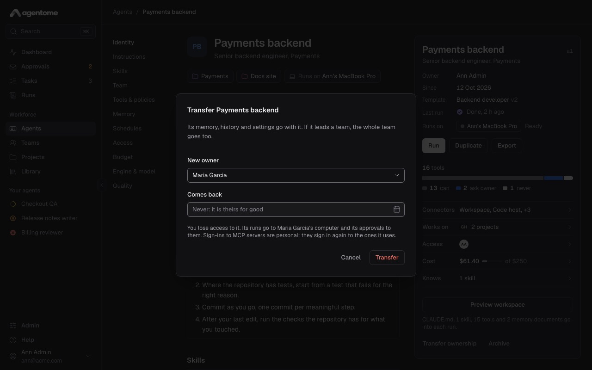

From then on, its runs go to the new owner's computer and its approvals to them, and you no longer
see it. With a return day, the agent comes back to you by itself on that day. Until then, the person
who has it can only send it back early: **Transfer ownership** on their sheet offers **Return now**.

Keep in mind:

- An agent that leads a team goes with its whole team. A member cannot be transferred alone:
  transfer the lead.
- An agent cannot be transferred while it is running: wait for the run to end, or cancel it.
- Sign-ins to MCP servers are personal: the new owner signs in again to the ones the agent uses.

When a person leaves, an admin can hand every agent they own to someone else at once with **Transfer
agents** in Admin → People; see [Administration](administration.md).

### Archive

Click **Archive** on the agent sheet and confirm. The agent takes no more runs, its queued runs are
cancelled, and it leaves the sidebar and the **Active** list. Its history stays. To bring it back,
open it from the **Archived** tab and click **Unarchive** on its sheet.

## Budget

The **Budget** section limits what one run, and a month of runs, may use. Save after editing.

### Per-run limits

**Minutes per run**, **Turns per run** and **Tokens per run**: a run stops at the first limit it
reaches. An empty field uses the platform default shown in it.

### Monthly limit

Needs a license key.

**Monthly limit, USD**: when the agent's spend this month reaches it, no new run starts. Its owners
hear of it at 80%. Leave it empty for no limit.

When a monthly limit is set, the section shows this month's spend against it. When the limit is
reached, new runs are refused and a **Continue this month** button lets the agent go on until the
month ends. To give it more room for good, raise the limit.

Project budgets and run limits across agents are in
[Approvals and control](approvals-and-control.md).

## Engine and model

The **Engine & model** section decides what runs the agent, where, and on which model. Save after
editing.

### Engine

- **Claude Code**: Anthropic's Claude Code. On the owner's computer it runs under the owner's Claude
  subscription; on the server, on a Claude model of a model connection.
- **Codex**: OpenAI's Codex. On the owner's computer it runs under the owner's ChatGPT sign-in; on
  the server, on a GPT or company model of a model connection. A Codex agent leads no team.

Changing the engine clears the model, since each engine has models of its own.

### Where it works

- **Owner’s computer**: the agent runs on its owner's connected computer, under their own
  subscription, while they are at the computer. No API key is needed. How to connect a computer is
  in [Where agents run](computers.md).
- **Server**: the agent works by itself on the company's server, with a model connection's key. No
  person's computer is needed, and actions still wait for a person where the tool policies say so.

### On the server

Needs a license key.

**Server** also needs a model connection. Until both are there, the option is unavailable, and the
line under it says what is missing. An admin adds model connections in Admin → Models; see
[Administration](administration.md).

### Model

On the owner's computer, **Model** offers **Default**, which lets the engine choose, and the
engine's models, such as Claude Opus 5.5 or Claude Sonnet 5.5 for Claude Code, and GPT-5 Codex or
GPT-5 for Codex.

On the server, first pick a **Model connection**, then a **Model** from that connection. Claude Code
runs Claude models only; Codex runs the rest.

An admin also sees **Allow a shell on the server** for a server agent. With a shell the agent could
read the connection's key, so turn it on only for an agent that has to run commands, such as tests.

## Quality

The **Quality** section shows how the agent's work landed over the last 30 days.

Needs a license key.

- **Accepted**: the share of tasks the agent handed over that people accepted.
- **At the first go**: of the accepted tasks, the share that never came back for more work.
- **Merged**: of its change requests that were decided, the share that was merged. Shown only for an
  agent that opens change requests.
- **Cost per task** (at API prices), **Agent time per task**, **Created to review** and **Failed
  runs**.
- **Came back**: how many times work returned after the agent handed it over, split by why: by
  people, for failed CI, or for a review.
- **Came back most**: the tasks that returned most often, with links. Read these first: what people
  had to ask for again is what the instructions miss.

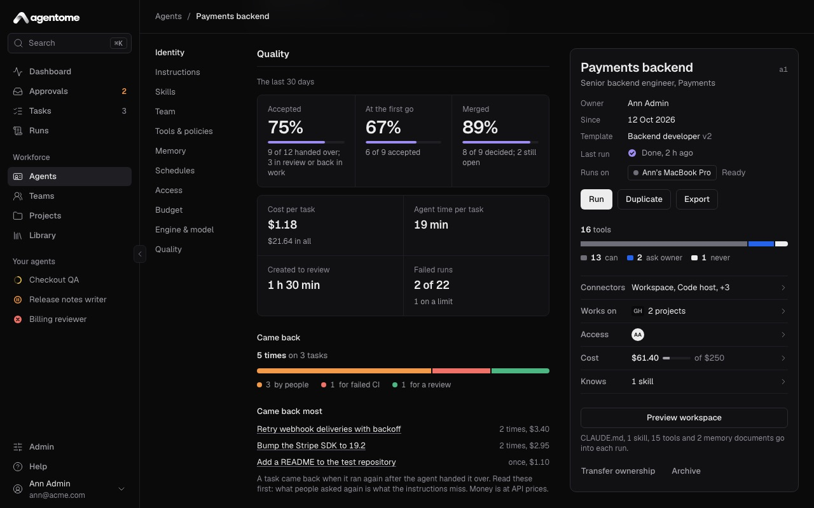
