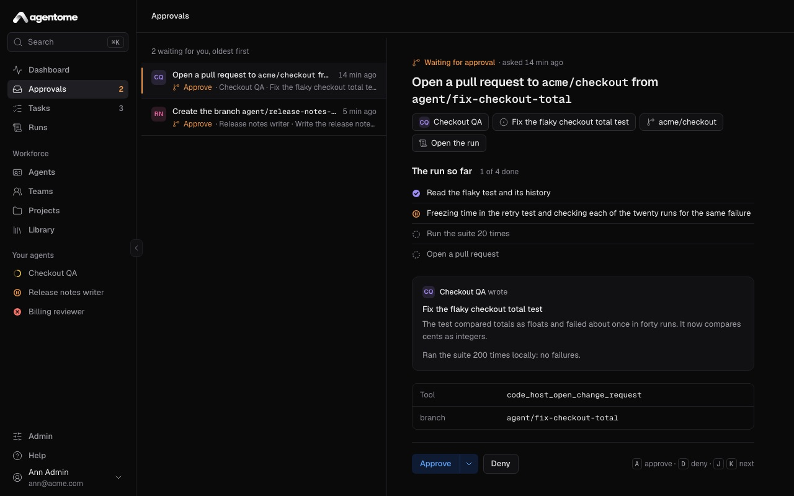
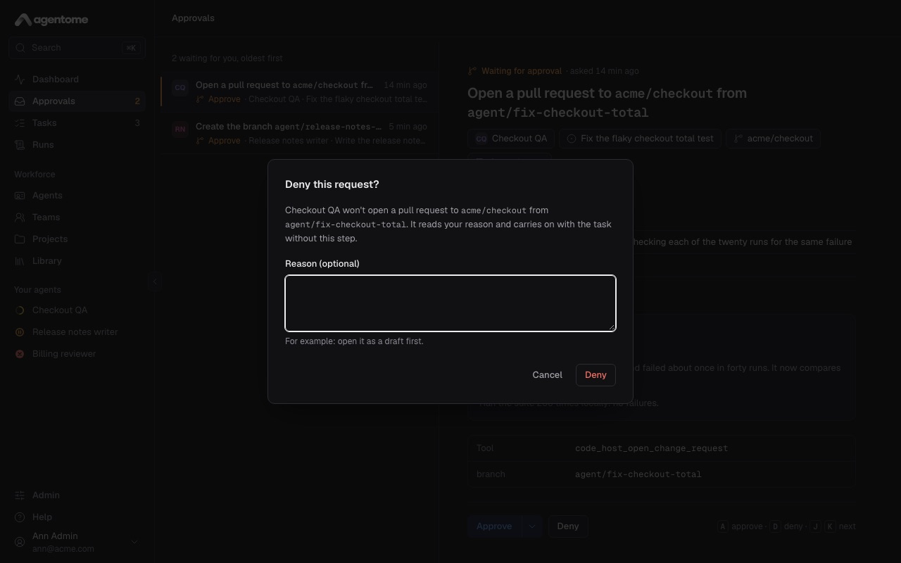
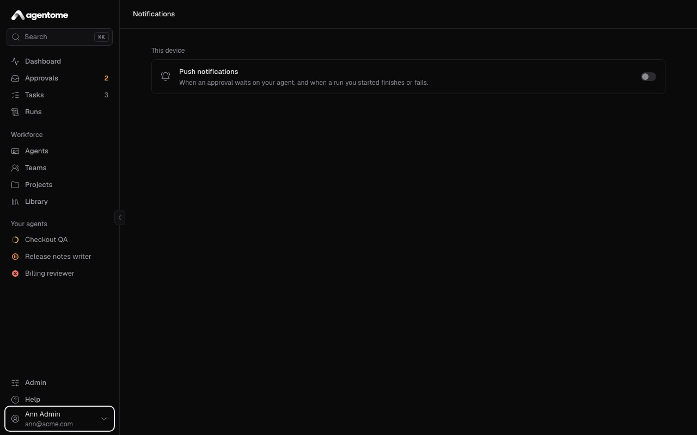
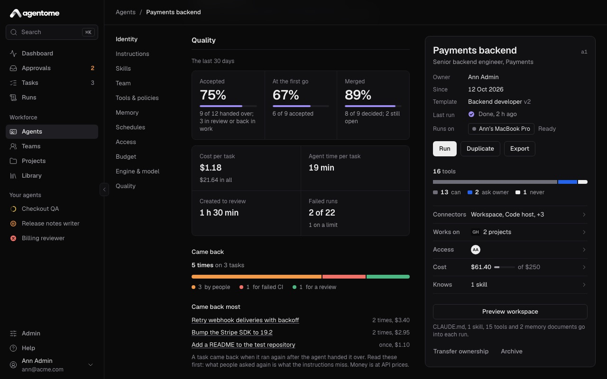
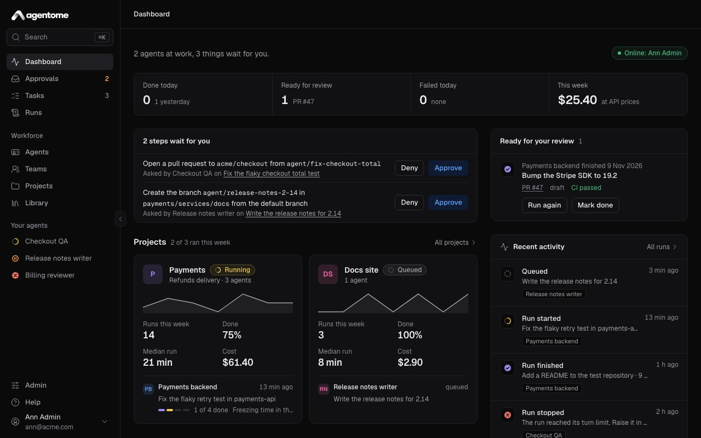

# Approvals and control

Agentome lets agents work on their own, and stops them where you say a person must decide. This page
covers tool policies, the Approvals page, questions agents ask, notifications on your phone, limits,
budgets, cost and quality.

- [Tool policies](#tool-policies)
- [The Approvals page](#the-approvals-page)
- [Questions from an agent](#questions-from-an-agent)
- [Who decides](#who-decides)
- [Notifications on your phone](#notifications-on-your-phone)
- [Limits per run](#limits-per-run)
- [Monthly budgets](#monthly-budgets)
- [The cost of a run](#the-cost-of-a-run)
- [Agent quality](#agent-quality)
- [The Dashboard](#the-dashboard)

## Tool policies

Every tool an agent can call through Agentome has a policy. You set it in the agent editor, in the
**Tools & policies** section. Each tool has three choices:

| Choice    | What happens when the agent calls the tool                                       |
| --------- | -------------------------------------------------------------------------------- |
| **Allow** | The call runs at once.                                                           |
| **Ask**   | The call waits in Approvals until the agent's owner approves or denies it.       |
| **Deny**  | The call is refused. The tool is not even offered to the agent in its next runs. |

Policies save as you change them. Above the list, **Auto** and **Manual** set every tool at once:
**Auto** lets every tool run without asking, **Manual** makes every tool ask first. Tools you set to
**Deny** stay denied either way.

The tools are grouped by where they reach: the code host, Jira, the task, memory, knowledge, the
team, and each MCP server you gave the agent. The **Workspace** group is always allowed: reading and
searching files, running commands in the sandbox, and keeping a to-do list. Those happen in the
agent's own clone and never leave it.

A new agent starts with these defaults:

- **Open a change request** and **Comment on the Jira issue** ask first, since other people read
  what they produce.
- Every tool of an MCP server from the Library asks first, since nobody has checked what it does.
- Everything else is allowed.

A call that waits holds its run: the run shows as waiting for approval, and goes on as soon as
someone decides. The time a run waits for a person does not count against its time limit.

## The Approvals page

**Approvals** in the sidebar lists everything that waits for you, oldest first. The page checks for
new requests every few seconds.

Pick a request to see:

- what the agent wants to do, in plain words;
- what the agent wrote, such as the title and description of a change request;
- the call itself: the tool and its arguments;
- the agent, the task and the repository, and a link to **Open the run**;
- **The run so far**: the agent's plan, with the steps it has done and the one it is on.

Then decide:

1. **Approve** lets the call run.
2. The arrow next to **Approve** (**More ways to approve**) has **Approve and stop asking**. The
   call runs, and from now on the agent uses that tool without asking you. You can change it back in
   the agent's **Tools & policies**.
3. **Deny** opens a dialog with a **Reason (optional)** field, such as "Open it as a draft first".
   The agent reads your reason and carries on with the task without this step.

The first decision wins. If a request disappears while you look at it, someone else decided or its
run ended. A request whose run was cancelled or ended is closed as denied.

### Keyboard

When no text field has focus:

| Key   | Action                       |
| ----- | ---------------------------- |
| **J** | Next request                 |
| **K** | Previous request             |
| **A** | Approve the selected request |
| **D** | Deny it (opens the dialog)   |

After you decide, the next request is selected, so you can go through the queue with the keyboard
alone.

### Other places to decide

The same requests appear where you already are:

- on the **Dashboard**, in a **Waiting for you** panel;
- on the page of the task the run belongs to;
- on the page of the run.

On a phone, **Approve** and **Deny** sit right in the list; tap a request to see all of it.

## Questions from an agent

Every agent can ask its owner a question in the middle of a run, for a decision only a person can
make: what is in scope, which of two options, what done means. The run waits for the answer. No
policy changes this: a question is always asked.

A question appears in Approvals, marked **Answer**, and in the same panels as a request. The agent
may offer answers to pick from.

1. Pick an offered answer, or type your own in the field. You can edit a picked answer.
2. Select **Send answer**. The agent reads your words and goes on.

Or select **Skip**. The agent is told that nobody will answer, goes on with its best judgement, and
says so in its report.

The keys **A** and **D** do nothing on a question: answer it in the form.

## Who decides

Only the agent's owner decides its requests and answers its questions. Other people, admins
included, do not see them in their Approvals.

When an agent is handed to someone for a time, such as during a holiday, that person is its owner
until the date, and decides in the meantime. From that date the requests go back to the owner. See
[Agents](agents.md) for handing an agent over, and
[Administration](administration.md#transfer-a-leaving-persons-agents) for moving everything a person
owns to a successor.

## Notifications on your phone

Agentome can send push notifications to your phone and to any browser where you turn them on. You
get one when:

- an agent of yours waits for your approval, or asks you a question;
- a run you started finishes or fails (for a run nobody started, such as one from Jira, the agent's
  owner hears of it);
- an agent of yours comments on a task;
- an agent of yours has used most of its monthly budget.

Tapping a notification opens the page it is about.

To turn them on:

1. Open Agentome on the phone at its HTTPS address. Browsers deliver notifications only over HTTPS;
   if your installation has none, ask an admin (see
   [HTTPS on a local network](../../deploy/OPERATIONS.md#https-on-a-local-network)).
2. On an iPhone or iPad, install the web app first: in Safari, tap **Share**, then **Add to Home
   Screen**, and open Agentome from the Home Screen. Notifications go only to the installed app.
3. Open **Notifications**: on a computer, from the menu under your name at the bottom of the
   sidebar; on a phone, from **More**.
4. Turn on **Push notifications**, and allow notifications when the browser asks.
5. Select **Send a test** to check that it arrives.

The switch is for this device only. Turn it on on each phone and browser you want notified. If
notifications are blocked for Agentome in the browser, allow them in its site settings and open the
page again.

## Limits per run

Every run has three limits, so that an agent that loses its way stops on its own:

| Limit   | Default   |
| ------- | --------- |
| Minutes | 60        |
| Turns   | 50        |
| Tokens  | 2,000,000 |

To change them for one agent, open the agent's **Budget** section and fill in **Minutes per run**,
**Turns per run** or **Tokens per run**. An empty field uses the default shown in it. An admin sets
the defaults for the whole installation (see [Run limits](../../deploy/CONFIG.md#run-limits)).

When a run reaches a limit, the computer stops it and the run fails with a message that names the
limit, for example "The run exceeded its time limit of 60 min and was stopped." The run keeps its
transcript and the cost so far. Look at what it did before you run the task again with a higher
limit or a smaller task.

Some details:

- Time spent waiting for your approval or answer does not count against the minutes.
- The turn limit applies to Claude Code. A Codex run is held to its minutes and tokens.
- Claude Code reports some token counts only at the end, so a run may stop somewhat later than its
  token limit says.

## Monthly budgets

Needs a license key.

A monthly budget limits what an agent or a project may spend in a calendar month, in US dollars at
API prices.

**For an agent:** in the agent's **Budget** section, fill in **Monthly limit, USD**. The section
then shows what the agent spent this month against its limit.

- At 80% of the limit, the agent's owners get a notification, once a month.
- At the limit, no new run of the agent starts. A run already going finishes, held by its own
  limits.
- To let the agent go on, select **Continue this month** in the **Budget** section. The agent then
  runs past its limit until the month ends. Or raise the limit.

**For a project:** on the project page, select the chip with the project's spend this month (or **No
monthly limit**), fill in **Monthly limit, USD** and select **Save**. The project's creator or an
admin can change it. At the limit, no new run of the project's tasks starts until someone raises it
or the month ends. An empty field means no limit.

A run refused for a budget says which limit was reached and what was spent against it.

Without a license key, a monthly limit cannot be set. One that is already set can be taken off.

## The cost of a run

Every run shows its cost in its **Cost** section, by model. The cost is worked out from the tokens
the engine reports at the end of the run, priced by the platform's price table.

The cost is always **at API prices**. On a person's computer, under their Claude or ChatGPT
subscription, the company pays the subscription, not per token: the figure then says what the run
would have cost with an API key. It is a fair way to compare agents and tasks, not an invoice.

While a run goes, the section says the cost is counted when it finishes. A model without a price in
the table shows **No price**, and the total leaves its tokens out.

You also see cost:

- on each task, per run and in total;
- on each project, for its week;
- on the Dashboard, for the week;
- in an agent's **Budget** section, for the month, when it has a monthly limit.

## Agent quality

Needs a license key.

The **Quality** section of the agent editor shows how the agent's work landed over the last 30 days.

| Figure                  | What it counts                                                                 |
| ----------------------- | ------------------------------------------------------------------------------ |
| **Accepted**            | Tasks accepted, out of those the agent handed over                             |
| **At the first go**     | Accepted tasks that never came back                                            |
| **Merged**              | Change requests merged, out of those decided (shown when the agent opens them) |
| **Cost per task**       | The median cost of a task, and the total                                       |
| **Agent time per task** | How long the agent worked on a task                                            |
| **Created to review**   | How long from a task's creation to its review                                  |
| **Failed runs**         | Runs that failed, and how many of them on a limit                              |

**Came back** shows how often work came back after the agent handed it over, split by why: sent back
by people, for failed CI, or for a review. **Came back most** lists the tasks that came back most
often. Read those first: what people asked for again is usually what the agent's instructions miss.

## The Dashboard

The **Dashboard** is the first page you see, and answers "what needs me today".

From top to bottom:

- A sentence with how many agents are at work and how many things wait for you, and who is online:
  the people whose computers can take a run now.
- Four figures, each a link: **Done today**, **Ready for review**, **Failed today**, and **This
  week**, the week's cost at API prices.
- **Waiting for you**: approvals and questions, decided right there.
- **Projects**: the projects that ran this week, with their runs going now.
- **Ready for your review**: tasks the agents finished, with their change request and pipeline.
  Select **Mark done** to close one, or **Run again**.
- **Failed today**: runs that failed, with the reason in words and **Run again**.
- **Recent activity**: the latest runs, with a link to **All runs**.

For how tasks and runs work, see [Projects and tasks](projects-and-tasks.md). For the ideas behind
owners, policies and runs, see [Concepts](concepts.md).
