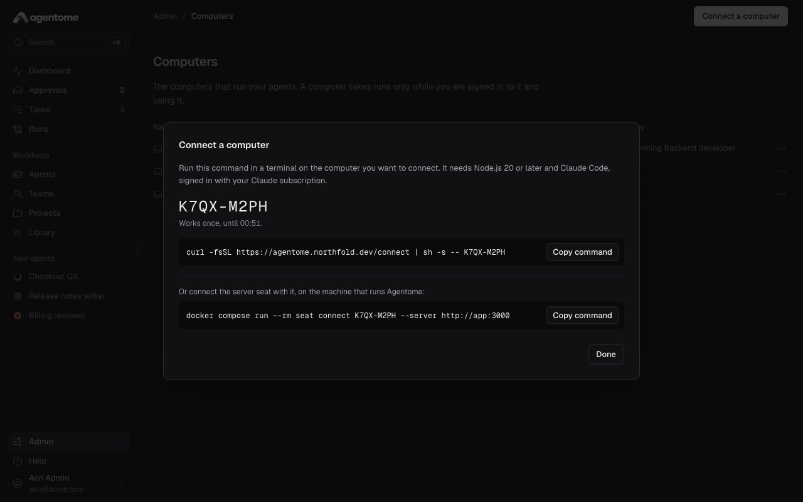
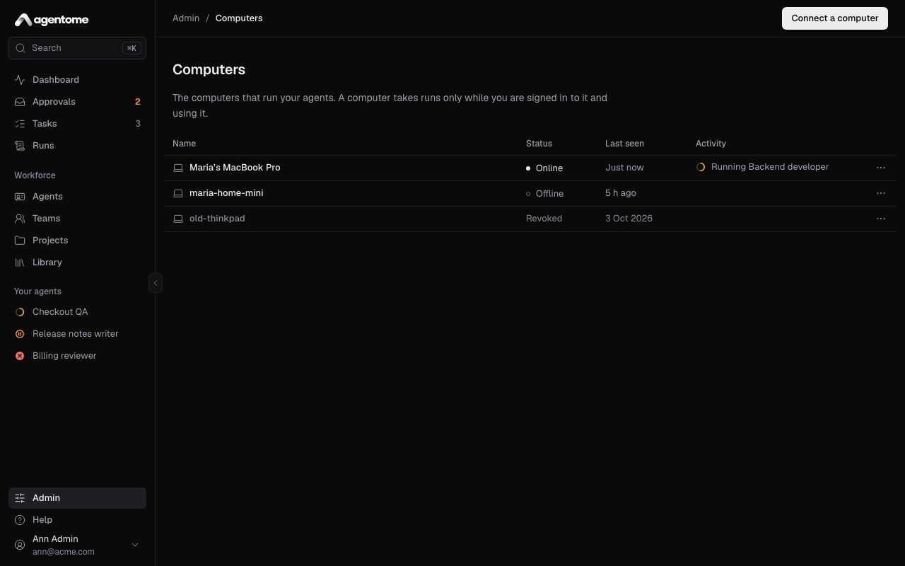
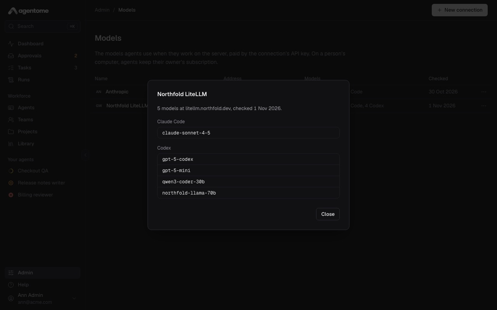

# Where agents run

This page explains where an agent's runs happen: on a person's computer under their own
subscription, or on the company's server with an API key. It shows how to connect a computer, what
the list in **Admin → Computers** tells you, how to keep the worker up to date, and how to start the
server seat.

## Two places to run

Each agent has a setting that says where it works: open the agent, go to the **Engine & model**
section and look at **Where it works**.

- **Owner's computer.** The agent runs on a connected computer of its owner, under the owner's own
  Claude subscription (Claude Code) or ChatGPT sign-in (Codex), and only while the owner is at that
  computer. No API key is needed. This is how most agents work.
- **Server.** The agent runs by itself on a server seat, with the API key of a model connection from
  **Admin → Models**. Nobody needs to be at a keyboard, and tool calls that your policies mark
  **Ask** still wait for a person. Needs a license key.

Either way, the agent's instructions, memory, history and settings stay on the Agentome server; the
machine only borrows them for one run.

A program called the worker does the running. On a computer it runs as a background service of your
login session. On the server it runs in its own container, the seat. In the API both are called
seats; the interface calls a person's machine a computer.

## What a computer needs

- **macOS, Linux or Windows.** The connect script installs the worker as a launchd agent on macOS,
  as a `systemd --user` service on Linux, and as a scheduled task that starts at logon on Windows.
  Windows has no sandbox for the agent's commands; see
  [Connect a Windows computer](#connect-a-windows-computer).
- **Node.js 20 or later** (`node -v`).
- **Claude Code**, installed and signed in with the Claude subscription the agents may use. Run
  `claude` and sign in. The connect command checks for it and stops if it is missing or signed out.
  Sign in with `claude` itself: a sign-in kept only in an environment variable does not reach the
  background service.
- **Codex**, for Codex agents: 0.163.0 or later (`npm install -g @openai/codex`), signed in with
  `codex login` under the person's ChatGPT subscription. The worker looks for `codex` on its `PATH`
  when it starts; the Codex inside the ChatGPT app is not on the `PATH` and is not found.
- **A server address over HTTPS.** Connect computers only once the server has an HTTPS address: the
  connect script downloads the worker from the server, and over plain HTTP anyone on the network
  path could hand the computer code of their own. See
  [HTTPS with the proxy profile](../../deploy/OPERATIONS.md#https-with-the-proxy-profile).

## Connect a computer

Every person connects their own computer. The runs of your agents go only to your computers.

1. Make sure Claude Code is installed and signed in: run `claude` in a terminal.
2. In Agentome, open **Admin → Computers**.
3. Click **Connect a computer**. With no computer connected yet, the button is in the middle of the
   page; otherwise it is at the top right.
4. The dialog says: "Run this command in a terminal on the computer you want to connect. It needs
   Node.js 20 or later and Claude Code or Codex, signed in with your own subscription." It shows a
   code and when it expires ("Works once, until 14:20."). The code works once, for ten minutes.
5. Click **Copy command** and run the command in a terminal on the computer:

   ```sh
   curl -fsSL https://agentome.example.com/connect | sh -s -- K7QX-M2PH
   ```

6. Click **Done**. The list reloads and shows your computer.



The command does this, in order:

1. Checks that Node.js 20 or later and Claude Code are there, and that Claude Code is signed in.
2. Downloads the worker as one file into `~/.agentome/bin/` and keeps it only if its SHA-256 matches
   the one the server names.
3. Connects the computer with the code.
4. Installs and starts the background service, which starts again each time you log in.
5. Prints how to check it: `~/.agentome/bin/agentome-worker status`.

If the service cannot be installed (no `systemd --user`, say), the computer is still connected, and
the command tells you to take runs in a terminal with `~/.agentome/bin/agentome-worker run`.

If the server runs from source with `pnpm dev`, the dialog shows a `pnpm` command and says **Run it
in a checkout of the repository**. The worker's own
[README](../../apps/worker/README.md#from-a-checkout) has the steps.

Running the connect command again with a new code connects the computer anew, as a new entry in the
list. Revoke the old entry then.

### Connect a Windows computer

The dialog has two tabs, **macOS or Linux** and **Windows**; in a browser on Windows it opens on
Windows. That command runs in PowerShell:

```powershell
& ([scriptblock]::Create((irm -UseBasicParsing https://agentome.example.com/connect.ps1))) K7QX-M2PH
```

The computer needs Node.js 20 or later, and Claude Code or Codex signed in with the person's own
subscription. Claude Code on Windows runs the agent's commands in Git Bash, so it needs Git for
Windows too. A computer with Codex alone takes the runs of Codex agents only.

The command says what Windows lacks, downloads the worker into `%USERPROFILE%\.agentome\bin` and
checks its checksum, connects the computer, and adds the scheduled task **Agentome worker**, which
starts the worker without a window each time the person logs in and starts it again after a crash.

Windows has no sandbox for the agent's commands. On macOS and Linux a command cannot read the
person's home folder or reach any host but Agentome's; on Windows it reads what the person can read
and reaches any address the computer reaches. So a Windows computer takes no runs until an admin
allows it:

1. The row in **Admin → Computers** says **Waiting for an admin**, and the runs of its agents wait
   in the queue.
2. An admin opens the row's menu and chooses **Allow runs without a sandbox**. The dialog says what
   the agent's commands can reach; **Allow runs** lets the computer take runs.
3. **Stop runs without a sandbox** in the same menu takes it back: the computer takes no more runs,
   and its run in progress is cancelled.

Allow it on a computer kept for work, such as a company virtual machine. Other differences on
Windows:

- A stopped run ends at once: Windows has no way to ask the CLI to finish first.
- What a finished CLI left running, a dev server say, is not stopped with it.
- The file tools still cannot open the computer's connection, the gateway's settings or the person's
  keys, but a command can.

Check the worker with `node $env:USERPROFILE\.agentome\bin\agentome-worker.mjs status`; its log is
`%USERPROFILE%\.agentome\logs\worker.log`. To update it, run the command from the Windows tab with
`update` in place of the code, or copy it from **Update the worker** in the row's menu. Run it in
PowerShell on the computer's desktop: from another session, such as SSH, Windows does not let it
stop the worker that runs, and it says so rather than start a second one.

The worker finds Claude Code and Codex on the PATH and where their installers put them without
adding them to it: `%USERPROFILE%\.local\bin` for Claude Code, `%APPDATA%\npm` for Codex.
To sign in to Codex on Windows, run `codex.cmd login`: PowerShell's default execution policy
refuses the `codex.ps1` that npm puts beside it. The worker and the connect command are not
affected by that policy.

### Check a connected computer

Run this on the computer:

```sh
~/.agentome/bin/agentome-worker status
```

It says which server the computer is connected to, whether the worker runs, when it last asked for a
run, the run in progress and whether the service is installed. When an engine is signed out it says
so ("not signed in, so its runs wait"), and when nobody has used the computer for a while it says
"Taking no runs". The worker's log is `~/.agentome/logs/worker.log`.

## The Computers list

**Admin → Computers** lists your computers. An admin sees every computer and seat. The page says:
"The computers that run your agents. A computer takes runs only while you are signed in to it and
using it."



Each row has these columns:

| Column        | What it shows                                                     |
| ------------- | ----------------------------------------------------------------- |
| **Name**      | The computer's name, with an icon for a computer or a server seat |
| **Status**    | **Online**, **Offline** or **Revoked**                            |
| **Last seen** | When the worker last asked for a run, or **Never**                |
| **Activity**  | What it is doing now, or why it cannot take a run (see below)     |

A computer is **Online** when its worker asked the server for a run in the last two minutes. An idle
worker asks every 25 seconds, and a busy one reports every 30 seconds. **Offline** means the
computer is off, asleep, logged out or not connected to the network. **Revoked** means it was
disconnected and can no longer take runs; the row stays as a record.

**Activity** shows one of these:

- **Running** and the agent's name: a run is in progress.
- **Claude Code is not signed in**, **Codex is not signed in**, or both: the engine said at the last
  claim that it is signed out. Runs of that engine wait in the queue. On that computer, run `claude`
  (or `codex login`) and sign in; the worker asks again within a minute.
- **Worker out of date**: the computer runs an older worker than the server hands out. It still
  takes runs. See [Update the worker](#update-the-worker).
- **Ready for runs**: online and waiting for work.

The list refreshes itself every 30 seconds. The **Dashboard** shows who is online, and the agent's
sheet shows the computer under **Runs on**, or **No computer connected**.

### Only while someone is at the computer

Before it asks for a run, the worker checks how long the keyboard and mouse have been idle. Past the
computer's idle time it takes nothing and looks again a minute later. A queued run then waits until
you are back. A run in progress is not stopped.

To change the idle time:

1. Open the row's menu (**Actions for** the computer) and choose **Settings**.
2. Change **Idle time, minutes**: a whole number from 5 to 120. The default is 15.
3. You can also change the **Name**, which shows next to the computer's runs.
4. Click **Save**. The worker picks the change up within a minute.

### Revoke a computer

To disconnect a computer, for example one you no longer use:

1. Open the row's menu and choose **Revoke seat**.
2. Confirm with **Revoke seat**.

The computer stops taking runs at once, and a run in progress on it is cancelled. At its next claim
the worker stops for good and removes its background service. To use the computer again, connect it
with a new code. A revoked row's menu has one item, **Remove from the list**; its past runs keep its
name.

## Update the worker

A connected computer keeps the worker it downloaded on the day it was connected. After the server is
updated, **Admin → Computers** shows **Worker out of date** on every computer whose worker is a
different build from the one the server now hands out.

1. Wait until the computer has no run in progress.
2. In the row's menu, choose **Update the worker**.
3. Click **Copy command** and run it in a terminal on that computer:

   ```sh
   curl -fsSL https://agentome.example.com/connect | sh -s -- update
   ```

4. Click **Done**.

The command downloads the worker, checks it against its checksum, replaces the file and starts the
background service again. The computer stays connected, with its name and settings, and the row
stops saying **Worker out of date** after the worker's next claim.

The command refuses while a run is in progress, and asks you to run it again when the run has
finished. If the worker runs in a terminal instead of the service, stop it there and start it again
by hand.

An old worker keeps working, but update it soon: the worker carries the sandbox that the agent's
commands run in. The server never puts a new worker on a computer by itself; a person always runs
the command. See
[The workers on people's computers](../../deploy/OPERATIONS.md#the-workers-on-peoples-computers).

## What happens during a run

1. The worker asks the server for a run of one of its owner's agents and gets the agent's profile,
   the task and a token that lives as long as the run.
2. It clones the task's repository into a folder in `~/.agentome/runs/`, or starts an empty one.
3. It starts Claude Code or Codex there under the owner's subscription, never an API key.
4. The agent reaches its tools (code host, Jira, memory, knowledge, library MCP servers) only
   through the server's MCP gateway, with the run's token. Integration tokens never reach the
   computer. A clone of a connected repository comes from the server's git proxy, and pushes go back
   through it, to branches under `agent/` only.
5. The worker streams the transcript, then reports the result, the commits and the usage.
6. It removes the run's folder.

The worker takes one run at a time. Its time limit leaves out time spent waiting for the owner.

The agent works in a sandbox the worker sets up: it cannot read the seat token, change its own
settings, or read the person's keys and tokens, such as ssh keys, cloud and registry credentials,
password stores and browser profiles. The repository's own `.claude` settings, hooks and `.mcp.json`
are never loaded.

A Codex agent's commands run in Codex's own sandbox. Before each run the worker checks that this
sandbox holds on the computer, and fails the run when it does not or when Codex is too old. One
limit: when the server's name resolves to a private address, a Codex agent on a computer cannot
`git push` through the git proxy; its tools still work. An agent on Claude Code has no such limit.

## What stays on the computer

Nothing of the agent. When a run ends, however it ends, the worker removes the run's folder: the
clone, the agent's instructions and settings, and what Claude Code kept of the run. The engine is
started so that it keeps no session transcript of its own. At start, the worker also removes the
folders of runs that a stopped worker left behind.

What stays in `~/.agentome` is the worker's own:

- `bin/`: the worker.
- `config.json`: the connection to the server and the seat token, readable by you alone.
- `logs/worker.log`: the worker's log.

One more thing can stay, and it is yours: when a task works in a folder on your computer and the run
ends **Done**, the agent's commits are pushed into that repository as a new branch,
`agentome/<run id>`. It is never one of your branches and is never forced.

To keep a run's folder for troubleshooting, set `AGENTOME_WORKER_KEEP_WORKSPACES=1` and run
`~/.agentome/bin/agentome-worker install-service` again. The worker's settings are in
[CONFIG.md](../../deploy/CONFIG.md#worker).

To stop the worker, run `~/.agentome/bin/agentome-worker uninstall-service`, which first cancels and
finishes a run in progress; to disconnect the computer, also revoke it in **Admin → Computers**.

## The server seat

Needs a license key.

An agent set to **Server** under **Where it works** runs on the server seat: a container next to the
Agentome server that runs Claude Code or Codex with a model connection's API key. It needs no person
at a keyboard. The seat is off until an admin starts it.

1. In **Admin → Models**, click **New connection** and add Anthropic or OpenAI with an API key, or a
   gateway such as LiteLLM or OpenRouter with its address and key. Use a key made for agents, with a
   spending limit at the provider.
2. In **Admin → Computers**, click **Connect a computer**. As an admin you see a second command
   under **Or connect the server seat with it, on the machine that runs Agentome**.
3. On the server machine, in the folder that holds `compose.yaml`, connect the seat and start it:

   ```sh
   docker compose run --rm seat connect <code> --server http://app:3000
   docker compose --profile server-seat up -d
   ```

4. Open an agent, go to **Engine & model**, choose **Server** under **Where it works**, and pick a
   **Model connection** and a **Model**: a Claude model for Claude Code, another model for Codex.
   Click **Save changes**.



Only an admin's code connects a server seat. The **Server** choice is greyed out until a model
connection exists and a license key is in.

How the seat behaves:

- It takes one run, exits, and Compose starts it again clean. Its file system is read-only apart
  from its connection and npm's cache.
- Its image holds Codex but not Claude Code. At each start the seat installs Claude Code from a
  pinned list with checksums. The first start needs a way to the npm registry and takes about half a
  minute; later starts take seconds. On a network without the registry, give the seat a mirror in
  `NPM_CONFIG_REGISTRY`.
- It reaches the server and the internet, not the database.
- Its agents have no shell unless an admin turns on **Allow a shell on the server** for that agent,
  in **Engine & model**. With a shell the agent could read the connection's key, so allow it only to
  an agent that has to run commands, such as tests.
- For more seats at once, start more: `docker compose --profile server-seat up -d --scale seat=3`.

The seat's worker comes in its image. When **Admin → Computers** shows it out of date, start it
again from the server's version with `docker compose --profile server-seat up -d`.

In production, run the seat on a machine of its own, pointed at your Agentome's address instead of
`http://app:3000`. The full operator steps are in
[Agents on the server](../../deploy/OPERATIONS.md#agents-on-the-server).

## Troubleshooting

| What you see                                        | What to do                                                                                                           |
| --------------------------------------------------- | -------------------------------------------------------------------------------------------------------------------- |
| The connect command says Node.js 20 is needed       | Install Node.js 20 or later, then run the command again with a new code.                                             |
| The connect command says Claude Code is needed      | Install Claude Code, run `claude` and sign in, then run the command again.                                           |
| "This code has expired" or "This code is not valid" | The code expired or was used. Click **Connect a computer** again for a new one.                                      |
| A task stays queued and the computer is **Offline** | Wake the computer and log in. The run starts at the next claim.                                                      |
| **Claude Code is not signed in**                    | On that computer, run `claude` and sign in (`codex login` for Codex). The worker asks again within a minute.         |
| Status says "Taking no runs"                        | Nobody has used the computer for longer than its idle time. Use it, or raise **Idle time, minutes** in **Settings**. |
| **Worker out of date**                              | Run the command from **Update the worker** on that computer.                                                         |
| The worker says "This computer was disconnected"    | The computer was revoked. Connect it again with a new code.                                                          |

More in [OPERATIONS.md](../../deploy/OPERATIONS.md#troubleshooting), [Concepts](concepts.md) and
[Getting started](getting-started.md).
