# Getting started

This page takes you from nothing to a first finished task: you install Agentome, create the
administrator, give agents a place to run, create an agent, put it on a project, file a task, watch
the run and review what came back. It takes about half an hour.

The words used here, such as run, seat and policy, are explained in [Concepts](concepts.md).

## Before you start

You need:

- A Linux or macOS machine in your network with Docker Engine 25 or newer and the Docker Compose
  plugin (`docker compose version` answers). This machine runs the Agentome server.
- One of these, for the agents to run on:
  - a work machine with Node.js 20 or later and Claude Code installed and signed in with your Claude
    subscription, or
  - an Anthropic or OpenAI API key, or the address and key of a gateway such as LiteLLM, for agents
    that work on the server. Needs a license key.

Everything in this guide works on Free, without a license key, unless a step says otherwise.

## 1. Install the server

Pick one of the two ways.

**With the install script.** On the server machine, run:

```sh
curl -fsSL https://raw.githubusercontent.com/agentome-ai/agentome/main/deploy/install.sh | sh
```

The script creates the folder `./agentome`, downloads `compose.yaml` into it, pulls the images from
Docker Hub and starts the server and PostgreSQL. When the server is healthy it prints a line like
this:

```text
Agentome is running. Open http://localhost:3000/setup to create the administrator, with the setup code <code>
```

Keep the setup code for step 2.

**From a checkout.** If the machine cannot reach Docker Hub, or you want to build from source:

```sh
git clone https://github.com/agentome-ai/agentome.git
cd agentome
docker compose up -d --build
docker compose exec app agentome setup-code
```

The last command prints the setup code. The server answers at `http://localhost:3000`.

If people will reach the server by any other address than `http://localhost:3000`, set
`AGENTOME_PUBLIC_URL` in `.env` before you go on, then run `docker compose up -d`. To connect other
people's computers you also need HTTPS: see
[HTTPS with the proxy profile](../../deploy/OPERATIONS.md#https-with-the-proxy-profile). All
settings are listed in [CONFIG.md](../../deploy/CONFIG.md).

## 2. Run the first-run setup

1. Open `/setup` on the server's address, for example `http://localhost:3000/setup`.
2. In **Setup code**, paste the code from step 1. If you lost it, run
   `docker compose exec app agentome setup-code` in the folder that holds `compose.yaml`, or look in
   the server's log with `docker compose logs app`.
3. In **Company name**, enter your company's name, such as Acme.
4. Under **Administrator**, fill in **Your name**, **Email**, **Password** (at least 12 characters)
   and **Confirm password**.
5. Click **Create the administrator account**.

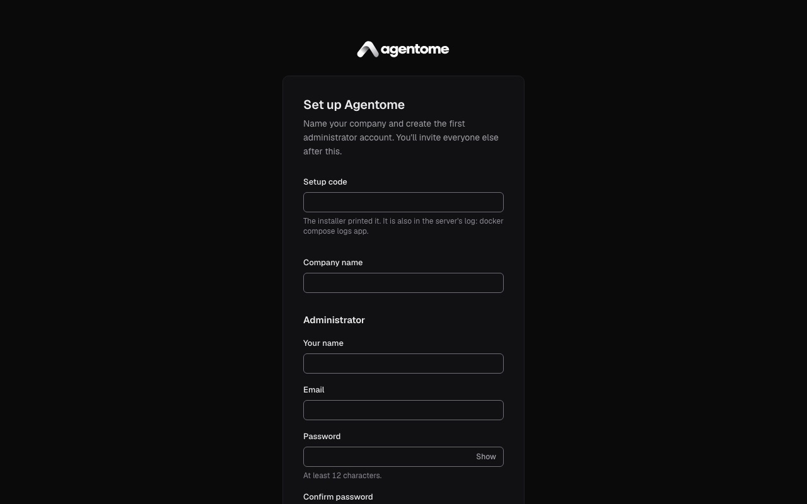

You are signed in as the first administrator and land on the **Dashboard**. The sidebar holds the
work (**Dashboard**, **Approvals**, **Tasks**, **Runs**) and, under **Workforce**, **Agents**,
**Teams**, **Projects** and **Library**. **Admin** and **Help** are at its foot. Press `⌘K`
(`Ctrl K` on Windows and Linux) anywhere to jump to a page.

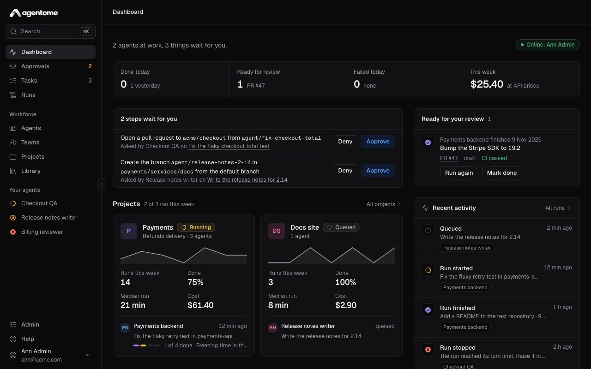

To bring in colleagues, open **Admin → People**, click **Invite someone** and send them the
invitation link. More in [Administration](administration.md).

## 3. Give agents a place to run

An agent needs somewhere to run. Choose one:

- **Your computer** (option A). The agent runs on your work machine under your own Claude
  subscription, only while you are at the computer. This is free and the usual way to start.
- **The server** (option B). The agent runs on a server seat with a model connection's API key, with
  nobody at a keyboard. Needs a license key.

### Option A: connect your computer

1. On the computer you want to connect, check that Claude Code is installed and signed in: run
   `claude`, and sign in with your Claude subscription if it asks. Node.js 20 or later must be
   installed too (`node -v`).
2. In Agentome, open **Admin → Computers** and click **Connect a computer**.
3. The dialog shows a one-time code and a command. Click **Copy command**. The code works once, for
   ten minutes; the dialog says until when.
4. Paste the command into a terminal on your computer and run it. It looks like this:

   ```sh
   curl -fsSL https://agentome.example.com/connect | sh -s -- K7QX-M2PH
   ```

   The script checks for Node.js and Claude Code, downloads the worker into `~/.agentome/bin`,
   checks it against its checksum, connects the computer and starts the worker as a background
   service of your login session.

5. Click **Done** in the dialog. Your computer appears in the list as **Online**, with **Ready for
   runs** under **Activity**.

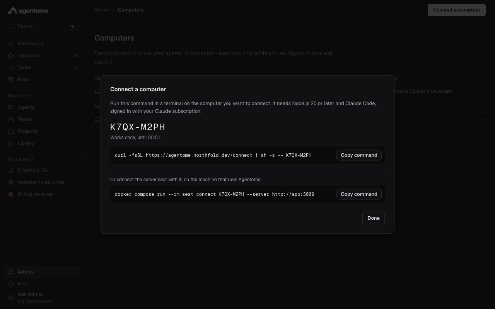

If the server runs from source with `pnpm dev`, the command is a `pnpm` command instead and the
dialog says **Run it in a checkout of the repository**. Everything about computers, including what
to do when a computer shows **Offline** or **Claude Code is not signed in**, is in
[Where agents run](computers.md).

### Option B: add a model connection for agents on the server

Needs a license key. An admin pastes one in **Admin → License**.

1. Open **Admin → Models** and click **New connection**.
2. Enter a name, such as "Anthropic for agents".
3. Pick the kind: **Anthropic** (Claude models, for Claude Code), **OpenAI** (GPT models, for Codex)
   or **Gateway** (LiteLLM, OpenRouter or another). For a gateway, enter its address.
4. Paste the **API key**. Use a key made for agents, with a spending limit at the provider.
5. Click **Connect**. Agentome lists the connection's models to check the key, and keeps the key
   encrypted.
6. Start the server seat. Open **Admin → Computers**, click **Connect a computer**, and copy the
   second command, under **Or connect the server seat with it**. On the server machine, in the
   folder that holds `compose.yaml`, run it and then start the seat:

   ```sh
   docker compose run --rm seat connect <code> --server http://app:3000
   docker compose --profile server-seat up -d
   ```

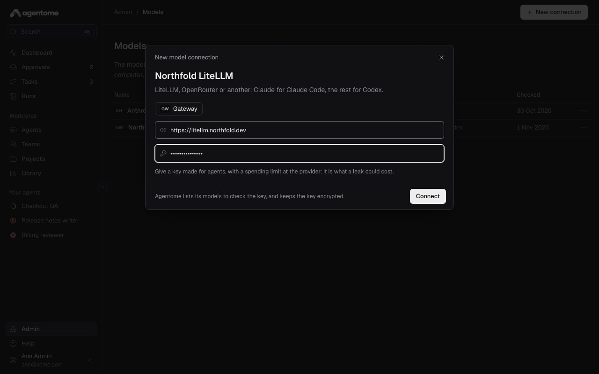

The details, including the seat's first start and its limits, are in
[The server seat](computers.md#the-server-seat).

## 4. Create a project

Every task is filed in a project. Any signed-in person can create one; its maker and the admins can
change it.

1. Open **Projects** and click **New project**.
2. Name it after the work, not the repository, such as "Payments".
3. Click **Create project**. The project's page opens.

On that page you can add a **Description** and **Goals**, which agents read with each task.
Repositories are optional for a first task:

- Without a repository, a task can work in a folder on your computer, or in a new, empty folder each
  run. Step 7 shows both.
- To work in a GitHub or GitLab repository, an admin connects the project to the code host in
  **Admin → Connections**, then adds the repository in the project's **Repositories** section. See
  [Projects and tasks](projects-and-tasks.md) and [Integrations](integrations.md).

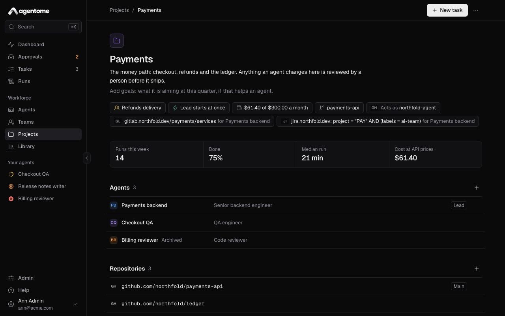

## 5. Create an agent

1. Open **Agents** and click **New agent**.
2. Pick a role template, or **Blank agent** to write the instructions yourself.
3. Check the **Name** and **Role title**, such as "Payments backend" and "Backend developer".
4. Click **Create agent**. The agent's editor opens.

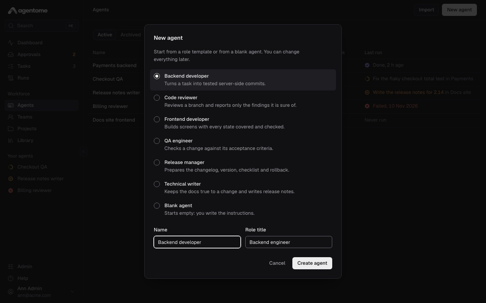

The editor is one page: its sections are listed on the left, and the agent's sheet, a summary of
what it is, stays on the right. For a first task, look at three sections:

- **Instructions.** What the agent is and how it works. A template fills this in; change it to suit
  your team.
- **Tools & policies.** For each tool the agent can call, choose **Allow**, **Ask** or **Deny**.
  **Ask** holds the call in **Approvals** until you approve it. **Auto** allows every tool and
  **Manual** asks for every tool, except the ones you deny. Policies save as you change them.
- **Engine & model.** Pick the **Engine**, **Claude Code** or **Codex**, and under **Where it
  works** pick **Owner's computer** or **Server**. On your computer, leave **Model** on **Default**
  to let the engine choose. On the server, pick a **Model connection** and a **Model**; the
  **Server** choice needs a license key and a model connection.

Click **Save changes** at the top when you are done. The other sections, such as **Skills**,
**Memory** and **Budget**, are described in [Agents](agents.md).

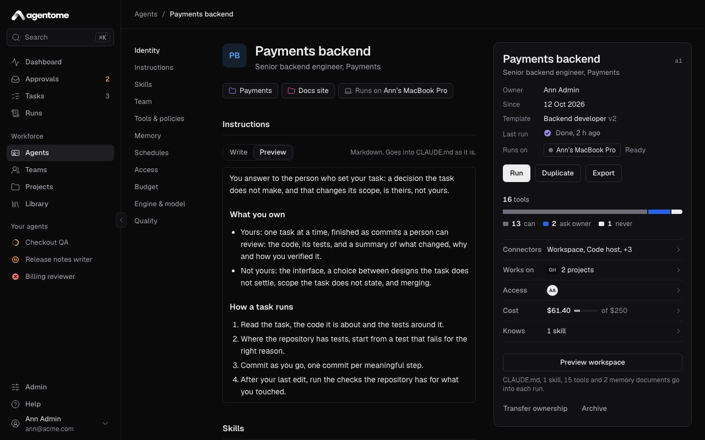

## 6. Put the agent on the project

Only a project's agents work on its tasks.

1. Open **Projects** and then your project.
2. In the **Agents** section, click the add button and pick your agent from the list (**Add
   agent**).

The agent is listed under **Agents**, and its sheet in the editor shows the project under **Works
on**. You can put only your own agents on a project you made; an admin can put any agent on any
project.

## 7. File a first task

1. Open **Tasks** and click **New task**.
2. Write a **Task title**, such as "Add a health check endpoint".
3. Describe what to do below it. The description is Markdown and goes to the agent as it is.
4. Under the description, choose:
   - the project, in **Choose a project**;
   - the agent, in **Choose an agent or a team**;
   - where it works. The chip opens a list: a repository of the project, a folder **On your
     computer** (type its path, such as `~/code/app`), or **No repository**, which gives the run a
     new empty folder each time.
5. Leave **Run now** on. The line next to it says where the run goes, such as "Runs on Ann's MacBook
   now", or that it waits for a computer.
6. Click **Create and run**. Press `⌘↵` (`Ctrl Enter`) to do the same from the keyboard.

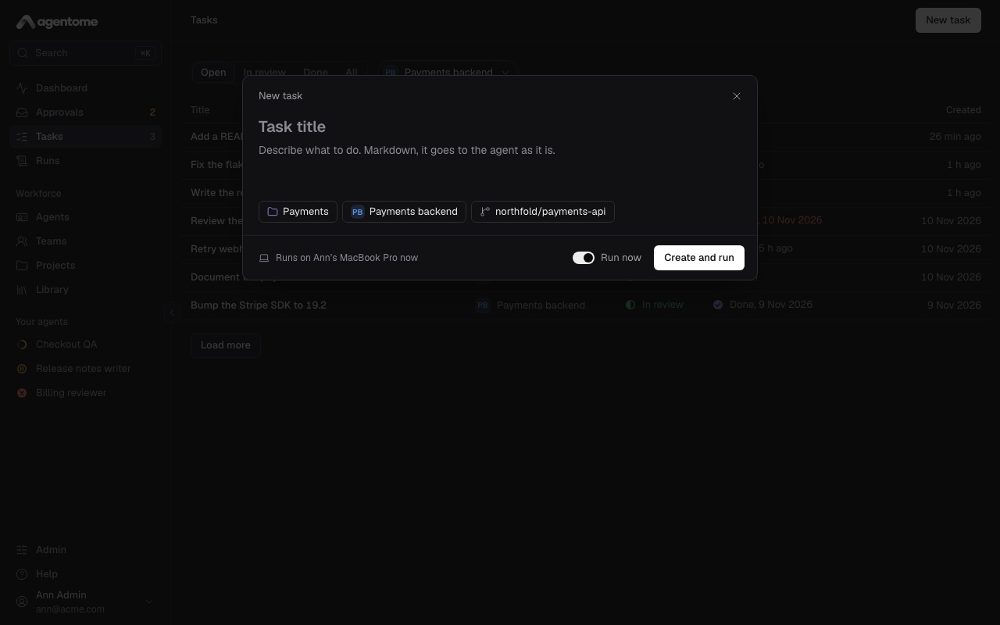

With **Run now** off, the button reads **Create task**, and the task waits until you click **Run**
on its page.

## 8. Watch the run

After **Create and run**, the run's page opens and follows the run live.

- At the top: the **Agent**, the **Task**, who ran it (**Ran by**), who started it and when.
- **Plan**: the agent's steps as it works through them, with how many are done.
- **Transcript**: every message and tool call. Click **Transcript** to fold or unfold it.
- On the right, **Results**: the branch, the report and the cost appear here when the run ends.

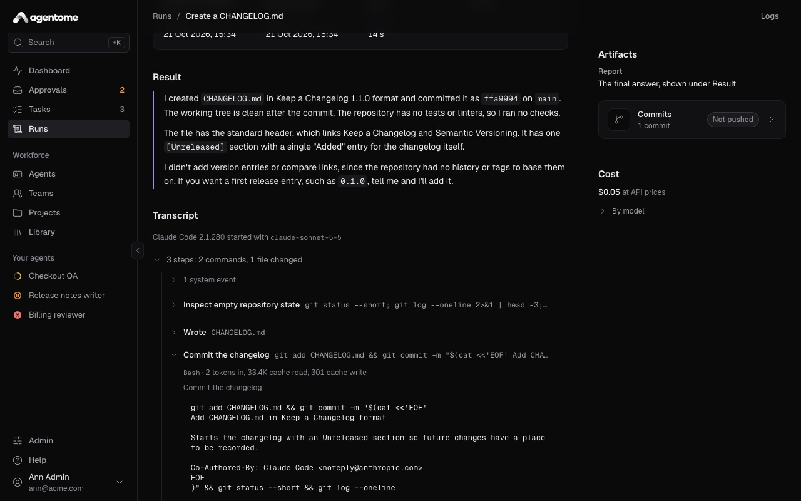

While the run is queued, the transcript says "Waiting for a computer to pick this run up." It starts
when your computer, or the server seat, takes it.

If a tool call needs your approval, the run shows **Waiting for you** with **Approve**, and the call
also waits in **Approvals** in the sidebar. Open it, read what the agent wants to do and click
**Approve** or **Deny**. More in [Approvals and control](approvals-and-control.md).

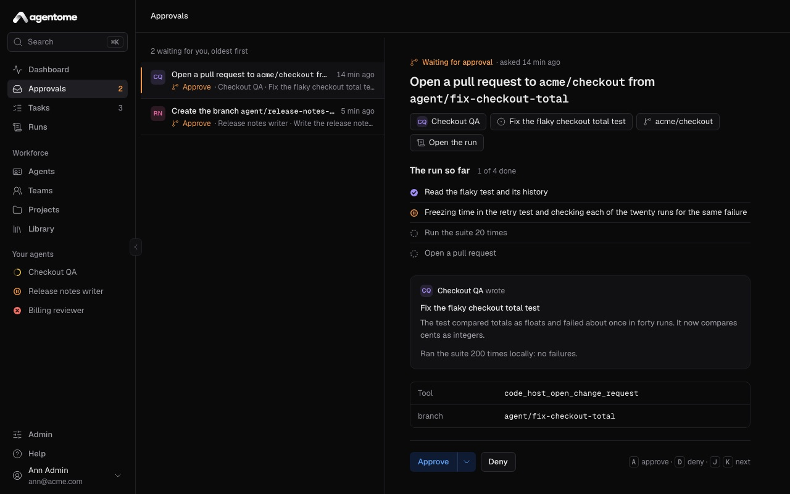

To stop a run, click **Cancel run** and confirm. What the run did so far stays in the transcript.

## 9. Review the result

When the run ends as **Done**, its page leads with the agent's answer, and the right column lists
the **Artifacts**: a **Report**, a **Branch** and, when the agent opened one, a **Merge or pull
request**. **Cost** shows what the run cost, **By model**.

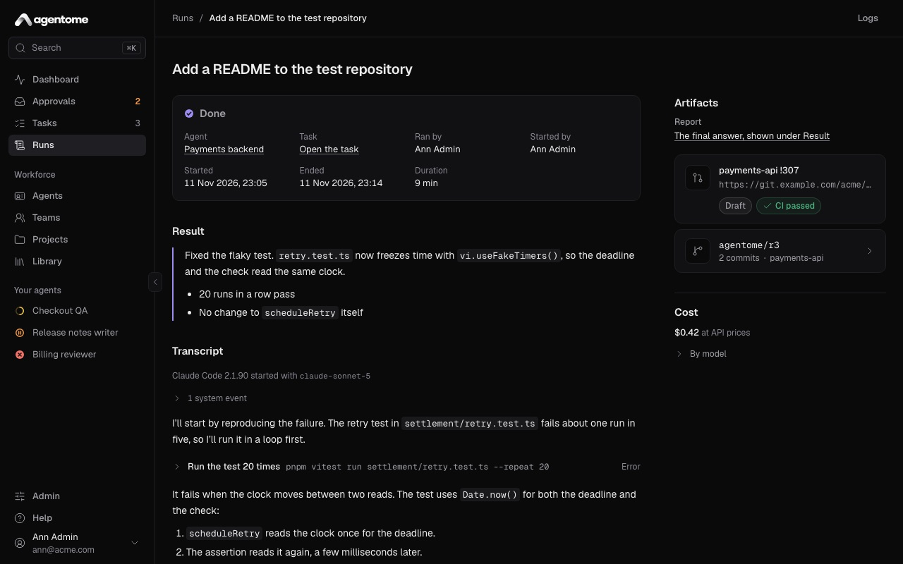

The task moves to **In review**, and the **Dashboard** lists it under **Ready for your review**.
Open the task (the **Task** link on the run, or **Tasks**, tab **In review**):

1. Read the report and look at the changes. If the task worked in a folder on your computer, the
   agent's commits are in that repository as a new branch, `agentome/<run id>`; your own branches
   are left as they were.
2. If it is what you wanted, click **Mark as done**.
3. If not, write to the agent in the comment field at the bottom ("Write to Payments backend: what
   to change, what you found") and click **Comment and run**. The next run reads your comment.
   **Comment** alone saves it for the next run, and **Run again** starts one without a comment.

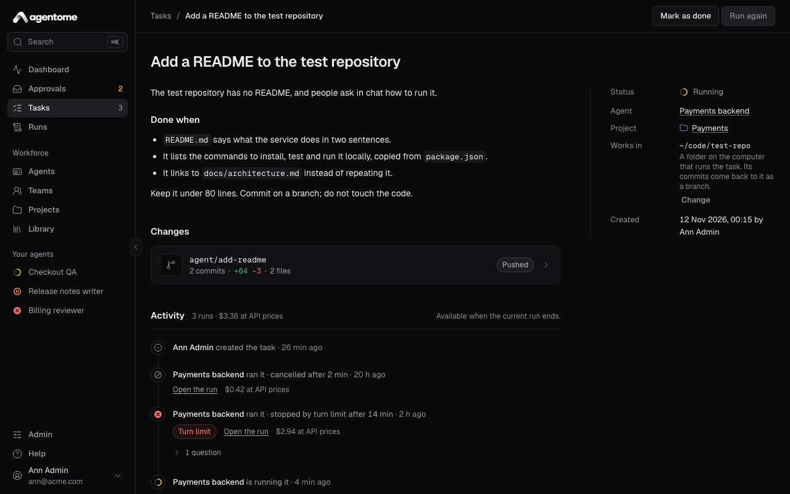

That is your first finished task.

## Where to go next

- [Concepts](concepts.md): the words of the product and how they fit.
- [Agents](agents.md): instructions, skills, memory, schedules, budgets and handing an agent over.
- [Projects and tasks](projects-and-tasks.md): repositories, knowledge and Jira.
- [Teams](teams.md): a lead that splits a task between its members.
- [Approvals and control](approvals-and-control.md): policies, approvals and limits.
- [Where agents run](computers.md): computers, the worker and the server seat.
- [Integrations](integrations.md): GitHub, GitLab, Jira and MCP servers.
- [Administration](administration.md): people, the license, logs and updates.
- [OPERATIONS.md](../../deploy/OPERATIONS.md): HTTPS, backups, updates and troubleshooting.
