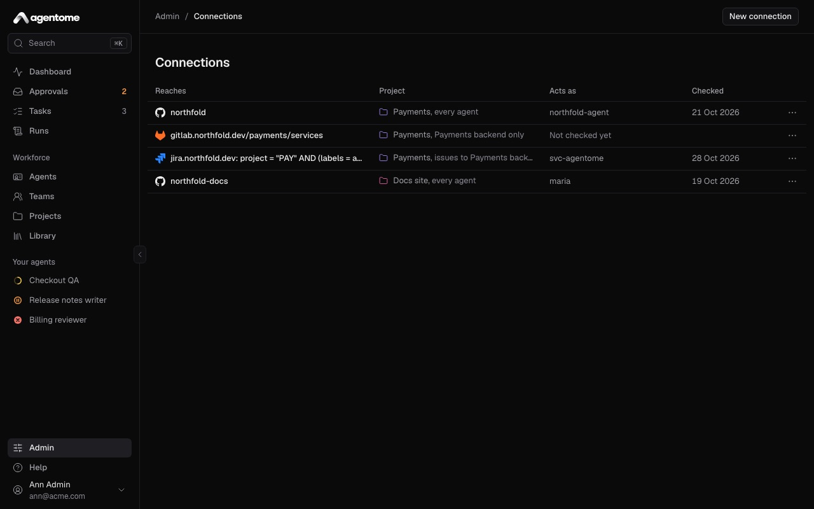
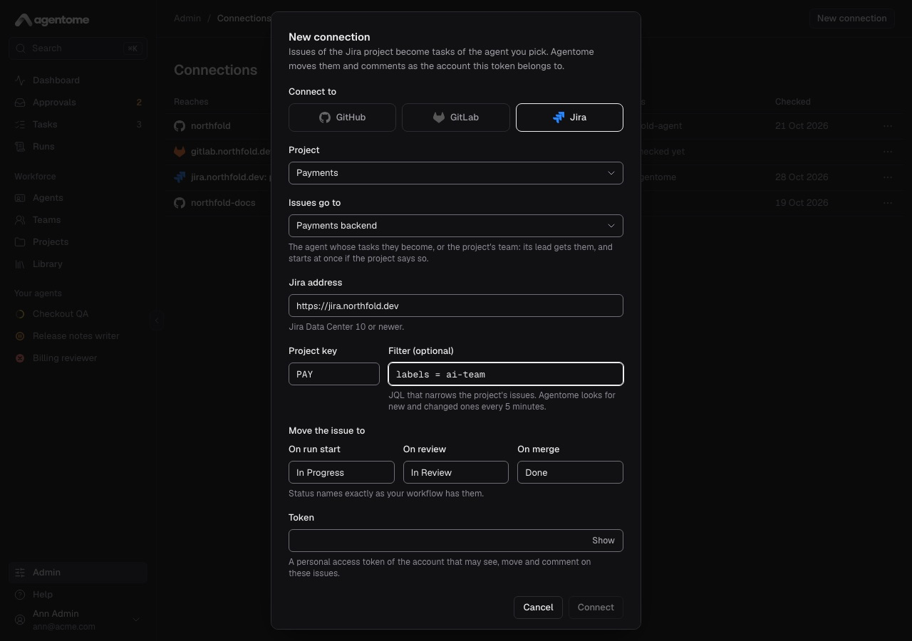
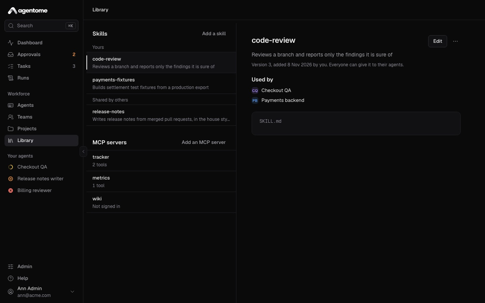
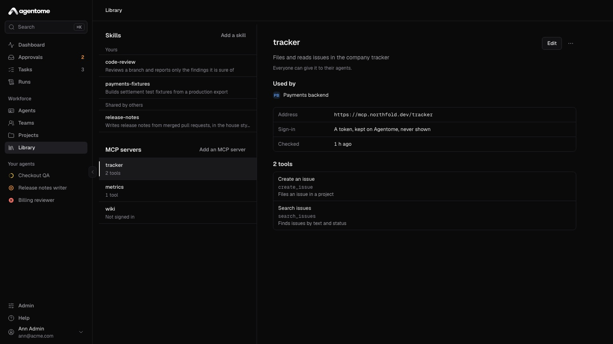
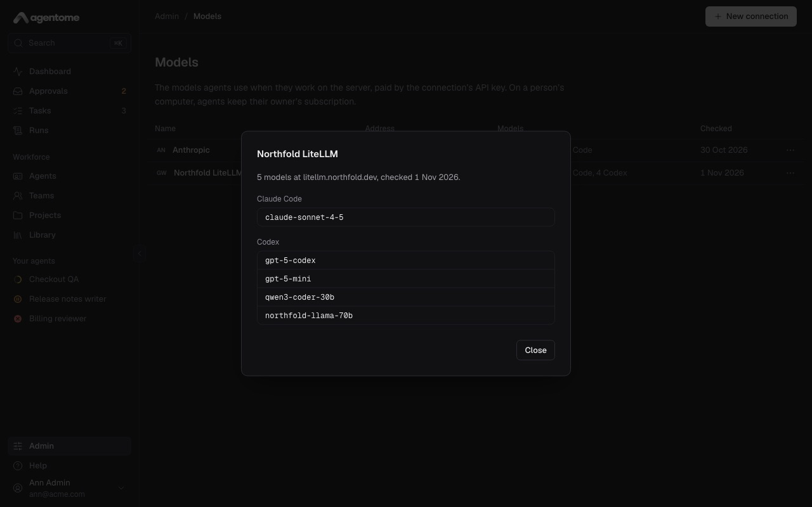
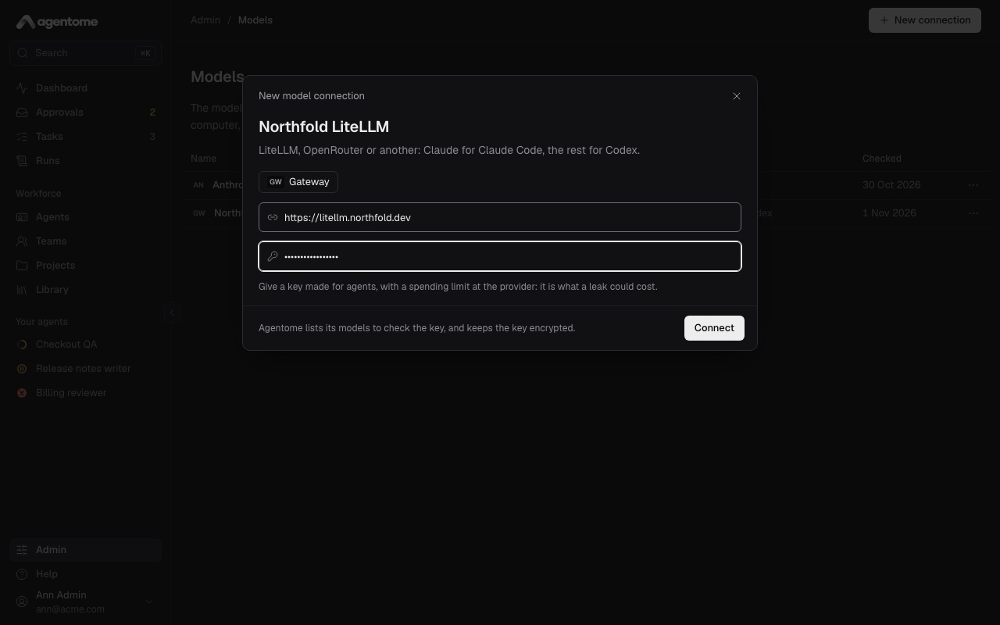

# Integrations

Agents work in your own systems: GitLab and GitHub for code, Jira Data Center for issues, any MCP
server for the rest, and the model provider of your choice for agents on the server. This page shows
how to connect each one, and what agents can and cannot do through it.

- [How agents reach your systems](#how-agents-reach-your-systems)
- [GitLab and GitHub](#gitlab-and-github)
- [Webhooks for pipelines and reviews](#webhooks-for-pipelines-and-reviews)
- [Jira Data Center](#jira-data-center)
- [MCP servers in the Library](#mcp-servers-in-the-library)
- [Model connections](#model-connections)
- [Sign-in with Keycloak](#sign-in-with-keycloak)

## How agents reach your systems

Integration tokens stay on the server. An agent never holds them, on a person's computer or on the
server:

- Its tools (open a change request, read a pipeline's failures, comment on a Jira issue, call an MCP
  server) go through the server's MCP gateway, with a token that lives as long as one run.
- `git clone` and `git push` go through the server's git proxy, which adds the connection's token on
  the way to the host.

Each call goes by the agent's tool policy: allowed, asked, or denied. See
[Approvals and control](approvals-and-control.md#tool-policies).

## GitLab and GitHub

A connection belongs to a project. It gives the agents of that project access to the repositories
under one GitLab group or one GitHub owner, as the account the token belongs to. Only admins manage
connections, and a project must exist first (see [Projects and tasks](projects-and-tasks.md)).

### Prepare a token

Decide which account the agents act as. A bot account and a person's account both work. Whatever the
agents do (branches, change requests, comments) shows that account's name on the host.

- **GitLab** (self-hosted): a token with `api` scope for the group.
- **GitHub** (github.com): a fine-grained token with **Contents** and **Pull requests**, read and
  write, for the repositories the agents should reach.

Give the account access only to what the agents need.

### Add the connection

1. Go to Admin → Connections and select **New connection**.
2. Under **Connect to**, pick **GitLab** or **GitHub**.
3. Pick the **Project**.
4. Under **For**, keep **Every agent of the project**, or pick one agent. An agent with a connection
   of its own acts as that account; the others use the project's.
5. For GitLab, fill in the **GitLab address**, such as `https://gitlab.acme.com`, and the **Group**,
   such as `acme/platform`. Subgroups are reached too. For GitHub, fill in the **Owner**: the user
   or organization, such as `acme`.
6. Paste the **Token** and select **Connect**.

The **Acts as** column shows the account the token belongs to once the token is checked. The row's
menu has:

- **Check the token**, to check it again and refresh the account;
- **Webhook settings**, for pipelines and reviews (see below);
- **Replace the token**, when it expires or is rotated;
- **Delete connection**. Agents of the project without a connection of their own then stop reaching
  its repositories.

The token is stored encrypted and never shown again.

### Cloning and pushing

A run clones the task's repository through the git proxy, on the computer that runs it. The agent
commits there and pushes back through the proxy. The proxy enforces three rules, whatever the agent
tries:

- It pushes only to branches named `agent/…`, such as `agent/add-readme`. It cannot push to `main`
  or any other branch.
- It cannot delete a branch.
- It cannot rewrite history. A push that does is undone, and the agent is told to rebase and push
  again.

The proxy opens only for a run that is still working. When the run ends, is cancelled or reaches its
time limit, its access ends with it.

### Change requests

When its work is ready, the agent opens a change request: a merge request on GitLab, a pull request
on GitHub. It may open it as a draft.

**Open a change request** asks the owner first by default. The request waits in Approvals with the
title and description the agent wrote, and opens only when you approve it. You can change that in
the agent's **Tools & policies**.

The change request is linked on the task, with its state and its pipeline. With webhooks set up (see
below), the task follows it: when the change request is merged, the task is done.

The agent can also read a change request and its review, read a pipeline's failures, and reply on a
change request. Each is a tool with its own policy.

## Webhooks for pipelines and reviews

Webhooks tell Agentome when a change request or its pipeline changes. Without them, the task does
not learn that its change request was merged or its pipeline failed.

1. In Admin → Connections, open the connection's menu and select **Webhook settings**.
2. Copy the **Payload URL** and the **Secret**. The URL has the form
   `https://<your server>/webhooks/gitlab/<connection>` or `.../webhooks/github/<connection>`.
3. Add a webhook on the host with them.

**On GitLab**, in each repository's settings under Webhooks, or once in the group's settings where
your GitLab edition has group webhooks:

- URL: the **Payload URL**.
- Secret token: the **Secret**.
- Triggers: merge request events, pipeline events and comments.

**On GitHub**, in the organization's or the repository's settings, under Webhooks:

- Payload URL: the **Payload URL**.
- Content type: `application/json`.
- Secret: the **Secret**.
- Events: pull requests, pull request reviews, check suites and workflow runs.

The host must reach your Agentome server at its public address.

### What a project does with them

On the project page, **When something happens** has three settings:

- **Fix failed pipelines**: when the pipeline of an agent's change request fails, the agent runs its
  task again to fix it.
- **Address review comments**: when someone asks for changes on an agent's change request, or
  comments on it, the agent runs its task again.
- **Review people's change requests**: a change request a person opens becomes a review task for the
  agent you pick. It reads the change and leaves its review as comments, and pushes nothing.

A webhook starts at most three runs a day for one task, and only within the budgets.

## Jira Data Center

A Jira connection turns the issues of a Jira project into tasks of an agent or of the project's
team, and moves the issues as the work goes. Agentome polls Jira, so there is nothing to set up on
the Jira side. Jira Data Center 10 or newer is supported.

### Prepare a token

Make a personal access token for the account that may see, move and comment on the issues. Agentome
moves issues and comments as that account.

### Add the connection

1. Go to Admin → Connections and select **New connection**.
2. Under **Connect to**, pick **Jira**.
3. Pick the **Project**.
4. Under **Issues go to**, pick an agent, or **The project's team**: its lead gets the issues and
   splits them, and starts at once if the project says so.
5. Fill in the **Jira address**, such as `https://jira.acme.com`, and the **Project key**, such as
   `PAY`.
6. Optionally, fill in **Filter (optional)** with JQL that narrows the project's issues, such as
   `labels = ai-team`. Only issues that match become tasks.
7. Under **Move the issue to**, give the status names of your workflow for **On run start**, **On
   review** and **On merge**. The defaults are In Progress, In Review and Done. Use the names
   exactly as your workflow has them.
8. Paste the **Token** and select **Connect**.

An issue's summary and description reach the agent as data, not as its task: the run is told to do
the work the issue describes, with the issue's words in a marked block that it is told not to obey.
That makes a planted instruction much less likely to work, not impossible. When the project's lead
starts on new issues at once, anyone who can file an issue in the filter starts a run: keep the
tools that write outside on **Ask** for such an agent, or let a person start each task.

### How issues and tasks follow each other

- Every 5 minutes Agentome looks for new and changed issues under the filter. **Sync issues now** in
  the connection's menu does not wait. An admin can change the interval (see
  [Server settings](../../deploy/CONFIG.md#server-settings)).
- A new issue becomes a task, in the project's main repository. When the issue changes, the task's
  title and description follow.
- When a run starts, the issue moves to the **On run start** status.
- When the agent opens a change request, it is linked on the issue, and the issue moves to the **On
  review** status.
- When the change request is merged, the issue moves to the **On merge** status.
- When a run ends, its summary becomes a comment on the issue.

The agent can also read the issue and comment on it during a run. **Comment on the Jira issue** asks
the owner first by default.

If Jira refuses a step, the task shows the error, and later steps try again.

## MCP servers in the Library

Any remote MCP server can give agents more tools: a tracker, a wiki, a database. You add it once to
the **Library**, then give it to agents.

### Add a server

1. Open **Library** and select **Add an MCP server**.
2. Fill in the **Name**, in lowercase, such as `tracker`. Its tools reach the agent as
   `tracker__<tool>`.
3. Fill in the **Address** of the server, such as `https://mcp.acme.com/mcp`. It must be a remote
   server over streamable HTTP.
4. Under **Sign-in**, pick one:
   - **A token**: paste it in **Token**. Agentome sends it as `Authorization: Bearer` and the token.
     Another scheme, such as Basic, can be typed whole. The token is optional.
   - **OAuth in the browser**: each person signs in with their own account.
5. Describe **What it does**, so others know when to use it.
6. Select **Add server**, or **Add and sign in** for OAuth.

Agentome checks the server and lists its tools.

### Secrets stay on the server

A server's token is kept on the Agentome server, encrypted, and is not shown again. It never reaches
a person's computer: an agent calls the server's tools through the MCP gateway, which adds the
token.

### Share it and give it to agents

A new server can be used only by the person who added it. An admin can select **Share with
everyone** in its menu, and then everyone can give it to their agents.

To give a server to an agent, open the agent's **Tools & policies** and pick it in **Add an MCP
server**. Its tools then appear under its name, and each asks first until you set it otherwise.

The server's menu also has **Check again**, to read its tools again after it changed, and
**Delete**.

### OAuth sign-in per person

With **OAuth in the browser**, each person signs in once with **Sign in** on the server's page in
the Library, and their agents use their account. A person who has not signed in sees **Not signed
in**, and the server lists its tools after they sign in.

Sign-ins are personal. When an agent passes to another owner, the new owner signs in again to the
servers it uses.

The server's authorization server must accept Agentome's return address. If the sign-in stops at
once with `invalid_request`, see
[MCP servers that sign in with OAuth](../../deploy/OPERATIONS.md#mcp-servers-that-sign-in-with-oauth).

## Model connections

Agents on people's computers run under their owner's own Claude or ChatGPT subscription, and need no
model connection. An agent that works on the server, by itself, needs one: an API key that the
company pays for.

### Add a connection

1. Go to Admin → Models and select **New connection**.
2. Give it a name.
3. Pick the kind:
   - **Anthropic**: Claude models, for Claude Code.
   - **OpenAI**: GPT models, for Codex.
   - **Gateway**: a gateway such as LiteLLM: Claude models for Claude Code, the rest for Codex. Fill
     in its address, such as `https://litellm.acme.com`.
4. Paste the **API key**. Use a key made for agents, with a spending limit at the provider: it is
   what a leak could cost.
5. Select **Connect**. Agentome lists the connection's models to check the key, and keeps the key
   encrypted.

The row's menu has **Models**, the models the connection offers by engine, **Check now**, **Edit**
and **Delete**. Deleting a connection erases its key, and agents on its models cannot work on the
server until they get another one.

### Put an agent on the server

Needs a license key.

In the agent's **Engine & model** section:

1. Under **Where it works**, pick **By itself**.
2. Pick the **Model connection** and the **Model**.

The server needs a seat that runs the agents. An admin starts it once; see
[Agents on the server](../../deploy/OPERATIONS.md#agents-on-the-server) and
[Computers](computers.md).

## Sign-in with Keycloak

Needs a license key.

People can sign in with the company's Keycloak, beside their passwords. An admin creates a client
for Agentome in the realm and sets three settings on the server; see
[Keycloak](../../deploy/CONFIG.md#keycloak).

Once it is on:

- The sign-in page offers **Sign in with Keycloak**.
- Anyone the realm lets in gets an account on their first sign-in, as a member. Who may come in is
  the realm's to say.
- A disabled person stays out, whatever the realm says.
- Sign-in with a password stays, so an admin can still get in when Keycloak is down.

Without a license key, people sign in with their passwords.
