# Projects and tasks

A project is the work your agents do for the company: its repositories, its connections, its
knowledge and the team that takes its tasks. Every task is filed in a project, and every run of a
task is recorded with its plan, transcript, report and cost.

- [Projects](#projects)
  - [Create a project](#create-a-project)
  - [Description and goals](#description-and-goals)
  - [Agents on a project](#agents-on-a-project)
  - [The project's team and who starts a task](#the-projects-team-and-who-starts-a-task)
  - [Repositories](#repositories)
  - [Connections](#connections)
  - [Knowledge](#knowledge)
  - [Monthly budget](#monthly-budget)
  - [When something happens: webhook triggers](#when-something-happens-webhook-triggers)
  - [Delete a project](#delete-a-project)
- [Tasks](#tasks)
  - [Create a task](#create-a-task)
  - [Where a task works](#where-a-task-works)
  - [The Tasks list](#the-tasks-list)
  - [The task page](#the-task-page)
  - [The thread](#the-thread)
  - [Status and review](#status-and-review)
  - [Tasks from Jira](#tasks-from-jira)
  - [Scheduled tasks](#scheduled-tasks)
- [Runs](#runs)
  - [Run statuses](#run-statuses)
  - [Follow a live run](#follow-a-live-run)
  - [When a run ends](#when-a-run-ends)
  - [Branches and change requests](#branches-and-change-requests)
  - [Cancel a run](#cancel-a-run)

## Projects

Open **Projects** in the sidebar to see every project with its number of agents and connections.

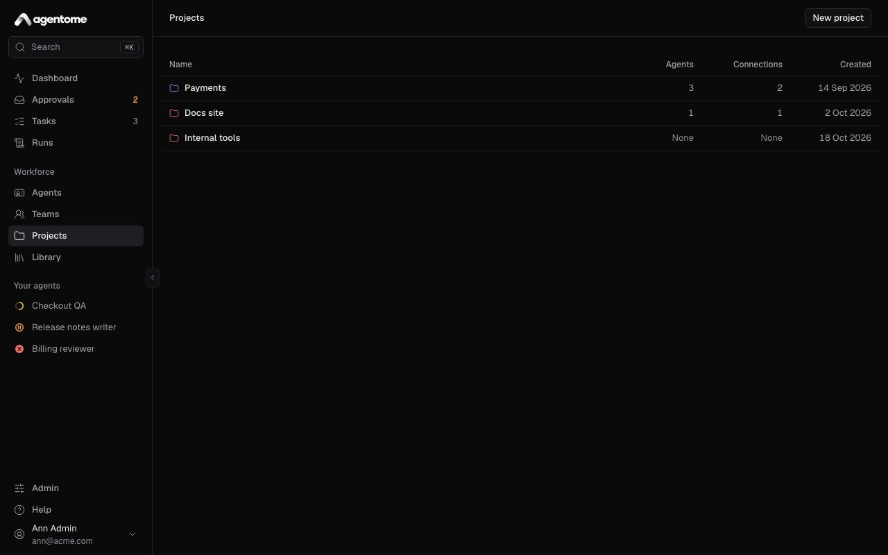

Anyone who can sign in can create a project. The person who made a project and any admin can change
it. Its repositories, connections and knowledge are an admin's to set up.

### Create a project

1. Open **Projects** and click **New project**.
2. Enter a **Name**. Name it after the work, not the repository: one project can reach several
   repositories.
3. Click **Create project**. The project's page opens.

Then fill the page from the top: a description, its agents, a team, and, for an admin, its
repositories and connections.

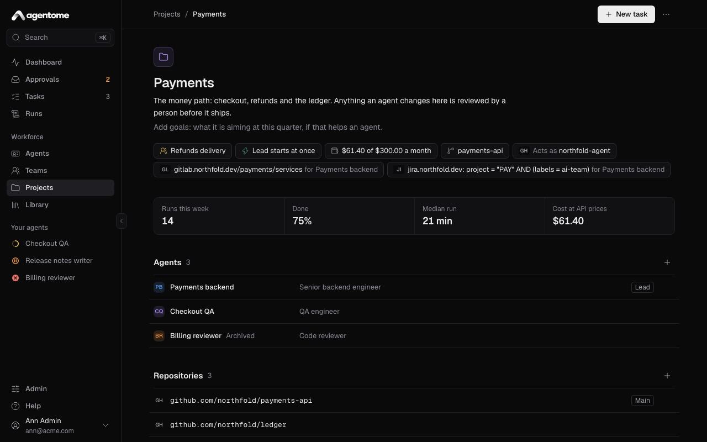

### Description and goals

Under the project's name are two fields:

- **Description**: what the project is for.
- **Goals**: what it is aiming at, this quarter for example, if that helps an agent.

Both are Markdown. An admin clicks the text to change it; it saves when you click away.

Every run of a task in the project gets a file named `PROJECT.md` in the agent's profile. It holds
the project's name, its description, its goals, and the list of its repositories with the main one
marked. The agent is told to read it before it starts. Keep both fields short: what goes past about
20,000 characters is cut, and the list of repositories always stays.

When a project has had runs this week, the page shows **Runs this week**, the share that ended
**Done**, the **Median run** and the **Cost at API prices**.

### Agents on a project

Only the agents on a project take its tasks and reach its repositories, connections and knowledge.

1. On the project's page, next to **Agents**, click the add button (**Add agent**).
2. Search for the agent and pick it.

An admin can add any active agent. The person who made the project can add their own agents. To take
an agent off, open its menu in the list and choose **Remove from project**.

The lead of the project's team is marked **Lead** in the list.

### The project's team and who starts a task

A project can have a team that takes its tasks. The team's lead gets each new task and splits it
between its members. See [Teams](teams.md) for how a team works.

To give the project a team:

1. Click the team chip under the description (it reads **No team** until you set one).
2. Under **Team that takes the tasks**, pick a team.

Its lead and every agent under it join the project, so that their runs reach its repositories,
connections and documents. A person who is not an admin can give a project only a team they own.

Once the project has a team, a second chip says who starts a new task. Click it to choose under
**Who starts a new task**:

- **A person starts it**: a new task waits for someone to press **Run**.
- **The lead takes it**: the lead starts on a new task at once, in its owner's place or on their
  computer while they are at work. The chip then reads **Lead starts at once**. With issues from
  Jira, that is anyone who can file one: see [Jira](integrations.md#add-the-connection).

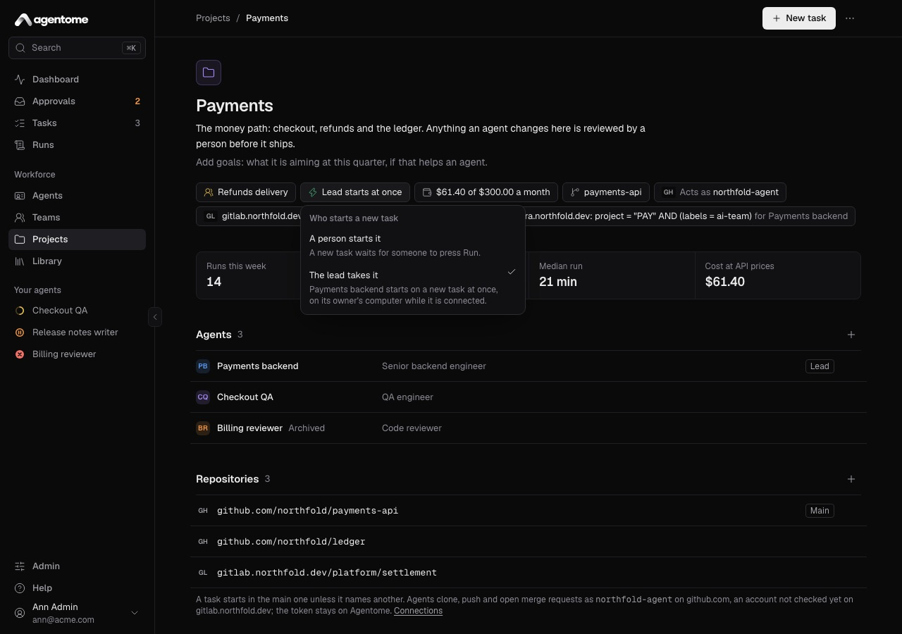

This choice applies to the project's **New task** button and to issues that arrive from Jira. The
**New task** button shows on the project's page once the project has a team.

### Repositories

The **Repositories** section lists the repositories the project's agents work in. An admin adds and
removes them.

1. Next to **Repositories**, click **Add repository**.
2. Enter the **URL**, for example `https://github.com/acme/api`. It must be under a GitHub owner or
   GitLab group this project is connected to.
3. Click **Add repository**.

The first repository is the main one, marked **Main**. A task starts there unless it names another,
and a task from Jira starts there. A new repository goes to the end of the list; to make it the main
one, open its menu and choose **Make main**. To take one off, choose **Remove**.

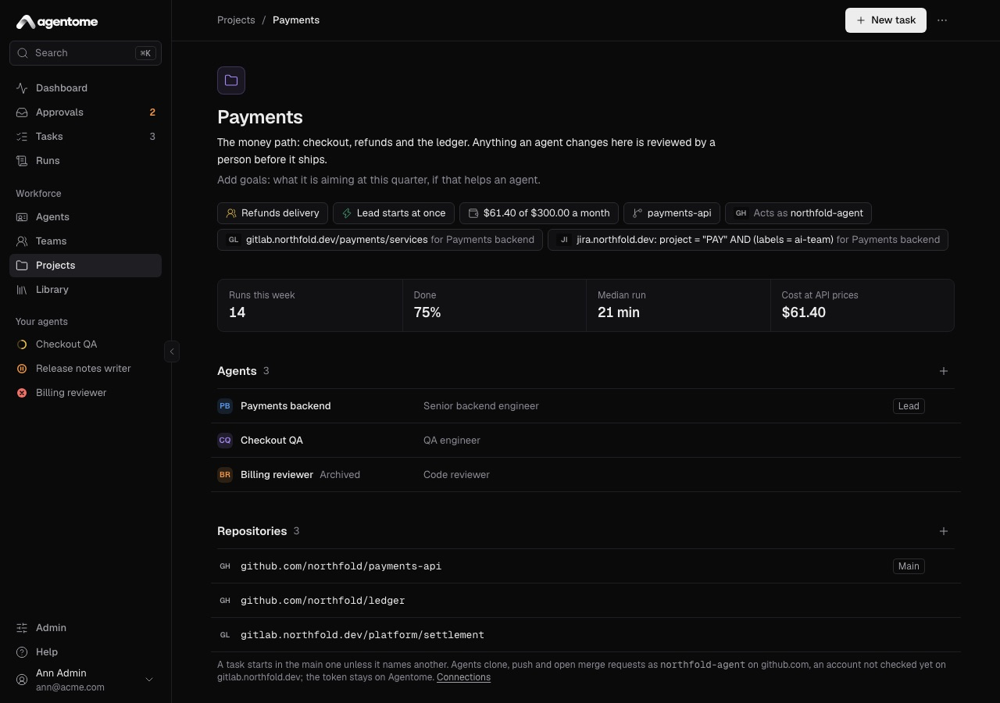

Under the list, the page says as which account the agents clone, push and open merge requests on
each code host. The token stays on the Agentome server and never reaches a computer. If the project
reaches no code host yet, its agents cannot push.

### Connections

A project's connections are how its agents reach GitHub, GitLab and Jira. An admin creates them in
Admin → Connections; see [Integrations](integrations.md).

Each connection shows as a chip on the project's page:

- A code host connection reads **Acts as** and the account it uses, for example **Acts as
  acme-bot**.
- A Jira connection shows its server and filter.
- A connection with an agent's own token adds **for** and the agent's name.

### Knowledge

Knowledge is Markdown from the project's repositories that its agents can search while they work. An
admin adds the sources.

1. Next to **Knowledge**, click **Add a source**.
2. Under **Repository**, choose one of the project's repositories.
3. Under **Paths**, list files or folders, separated by commas. The default is `README.md, docs`. A
   folder brings every Markdown file under it.
4. Click **Add and sync**.

The server reads the files from the repository's default branch through the project's connection,
and syncs each source again every hour. Each source shows how many documents it holds and when it
was last synced, or **Not synced yet**, or **Sync failed** with the reason. To sync at once, open
the source's menu and choose **Sync now**; to take it off, choose **Remove**.

Agents search knowledge with two tools: `knowledge_search` finds documents by words, best matches
first, with a snippet; `knowledge_read` reads a whole document. An agent searches only the documents
of the projects it is on, as of the last sync.

### Monthly budget

Needs a license key.

A project can have a limit on what the runs of its tasks cost in a calendar month. The budget chip
shows what they cost this month, for example **$42.10 of $200.00 a month**, or **No monthly limit**.

1. Click the budget chip.
2. Enter the **Monthly limit, USD**. Leave it empty for no limit.
3. Click **Save**.

At the limit, no new run of the project's tasks starts. The chip turns red. Costs are counted at API
prices, also for runs on a subscription. Without a license key you can remove a limit, but not set
one.

### When something happens: webhook triggers

Under **When something happens**, a project can start runs by itself when its code host reports
something. Each is off until you switch it on, since each one spends a run.

- **Fix failed pipelines**: when the pipeline of an agent's change request fails, the agent runs its
  task again to fix it on the same branch.
- **Address review comments**: when someone asks for changes on an agent's change request, or
  comments on it, the agent runs its task again to address the review.
- **Review people's change requests**: pick an agent. A change request a person opens becomes a
  review task for this agent, titled **Review:** and the change request's title, and runs at once.
  The agent leaves its review as comments and pushes nothing. Choose **Nobody** to turn it off.

These runs happen at most three times a day for one task, and only within the budgets. Reviews and
change requests made by the connection's own account start nothing. The person who made the project
can choose only one of their own agents as the reviewer.

For any of this to work, the code host must send its webhooks to Agentome. An admin finds the
address and secret under Admin → Connections, in the connection's **Webhook settings**. See
[Integrations](integrations.md).

### Delete a project

1. On the project's page, open **More actions** and choose **Delete project…**.
2. Confirm with **Delete project**.

Its connections and their tokens, its knowledge and its agents' assignments go. Its tasks and runs
stay, filed in no project. Webhooks that GitHub or GitLab sends stay set up on the host until you
remove them there.

## Tasks

A task is a piece of work for an agent or a team: a title, a description in Markdown, the project it
is filed in, and where it works. A task can run many times; each time is a run.

### Create a task

You can start a task from **New task** on the **Tasks** page, from **New task** on a project's page,
or from **Run** on an agent's page.

1. Click **New task**.
2. Type the **Task title**. Press Enter to move to the description.
3. Describe what to do. It is Markdown and goes to the agent as it is.
4. Set the three chips under the text:
   - The project: **Choose a project**. Every task is filed in a project.
   - Who it is for: **Choose an agent or a team**. The menu lists **Teams** first, each led by an
     agent who splits the task, then **Agents**. Only the project's agents and teams whose lead is
     on the project are offered. A project with a team picks its team for you.
   - Where it works: the project's main repository by default. See
     [Where a task works](#where-a-task-works).
5. Leave **Run now** on to start at once, or turn it off to create the task and run it later.
6. Click **Create and run**, or **Create task** when **Run now** is off. Cmd+Enter or Ctrl+Enter
   does the same.

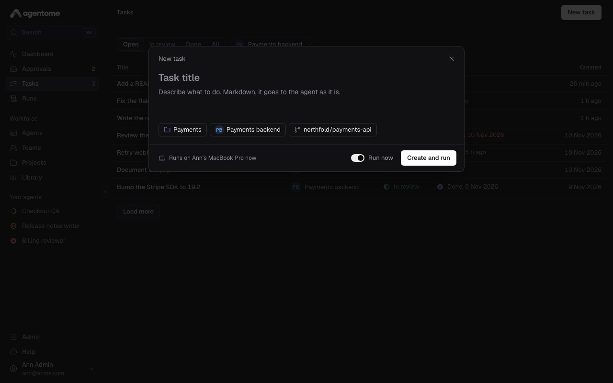

The line beside **Run now** says where the run goes, for example **Runs on** a computer **now**,
**when it's free** or **when it's online**. With no computer connected yet, the run waits for one.
See [Computers](computers.md).

With **Run now** on, the run's page opens so you can follow it. Otherwise the task's page opens.

If none of your agents is on the project, the dialog says so and links to the project's page.

### Where a task works

The chip for where it works opens a picker with two kinds of places:

- **Repositories**: the project's repositories, the main one marked **Main**. The agent works in a
  fresh clone, made through the server's git proxy. It pushes to branches under `agent/` and opens
  change requests through the server.
- **On your computer**: a folder on the computer that runs the task, such as `~/code/app`. Type its
  path, absolute or starting with `~/`. The picker also offers the folders of your recent tasks.

You can also type a repository URL that starts with `https://` or `http://`. Do not put a user name
or password in it: the computer clones without credentials.

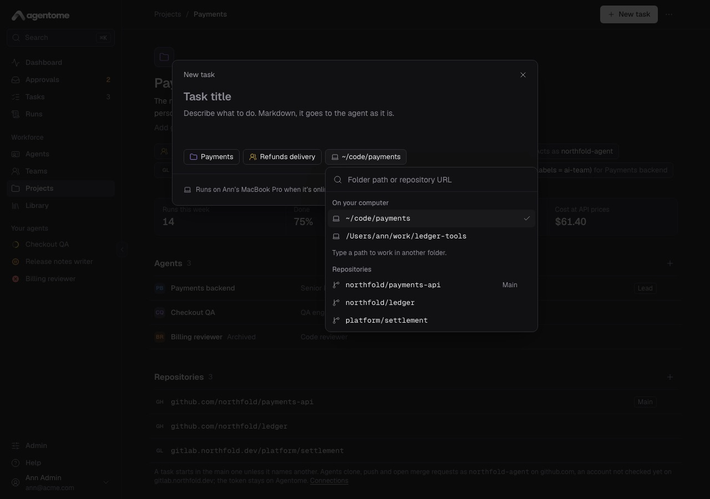

A folder must be a git repository. The agent never works in it directly: the run works in a clone,
and when the run ends **Done**, the commits it made come back to the folder as a new branch named
`agentome/<run id>`. Your own branches and your working copy are not touched. If the run fails or is
cancelled, its commits are not brought back.

A project with no repository yet offers **No repository**: each run then starts in a new, empty
folder.

### The Tasks list

**Tasks** lists the tasks of your agents.

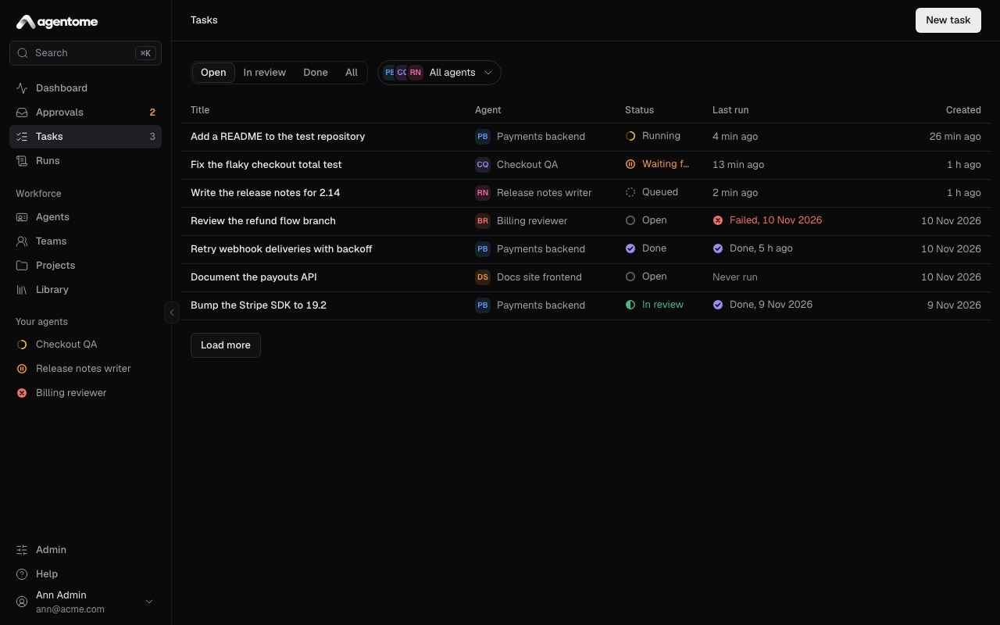

- The tabs filter by status: **Open** (the default), **In review**, **Done** and **All**.
- The agent filter, **All agents** by default, narrows the list to one agent.
- Each row shows the **Title**, **Agent**, **Status**, **Last run** and **Created**. While a run
  goes, the status reads as the run does: **Queued**, **Running** or **Waiting for you**.
- **Load more** brings the next page.

Click a row to open the task.

### The task page

The task page has the title and description on the left, and the task's properties on the right.

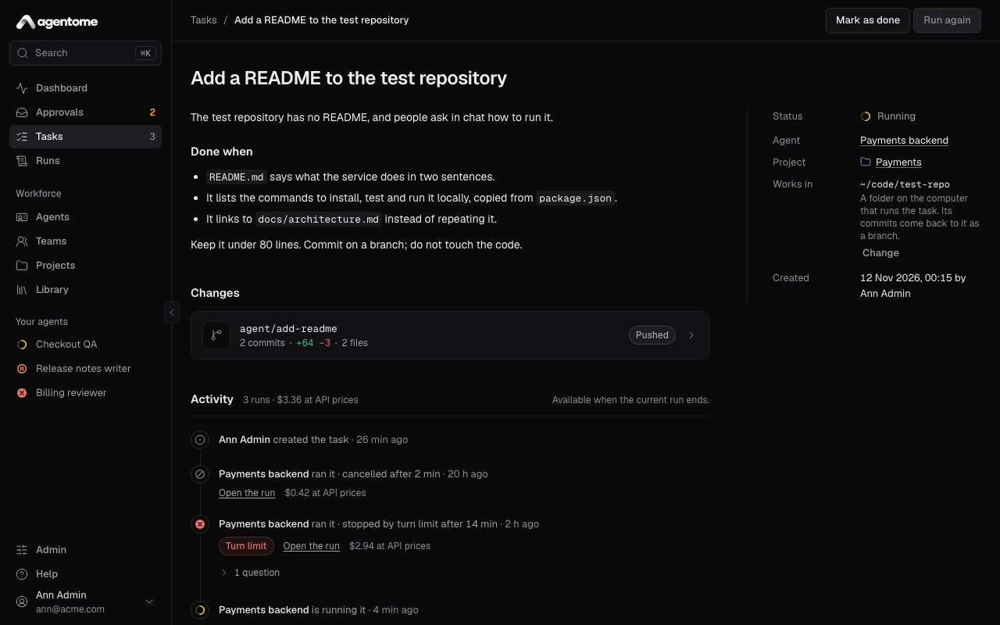

The properties are:

- **Status**: the task's status, or its run's while one is going.
- **Agent**: who does the task.
- **Project**: the project it is filed in.
- **Works in**: the repository or folder its next run starts in. When it is the project's main
  repository, the page says so; the task then follows the project if the main repository changes.
  Click **Change** to pick another place.
- **Jira**: for a task from Jira, what Jira refused when the task reported back, until a later step
  goes through.
- **Created**: when, and by whom.

Click the title or the description to change it. The run going now keeps the old text; the next one
reads the new one.

At the top right:

- **Run**, or **Run again** once the task has runs, queues a new run. It is unavailable while a run
  of the task is going, and for an archived agent.
- **Mark as done** closes the task. **Reopen** opens it again.

Below the description:

- **Changes** shows the change requests and branches the task's runs left. See
  [Branches and change requests](#branches-and-change-requests).
- **Assigned** lists the tasks a team lead handed to the leads under it. See
  [Teams](teams.md#nested-teams).
- **Activity** is the task's history and its thread.

### The thread

**Activity** tells the task's life, oldest first: who created it, each run with how it ended, and
every comment.

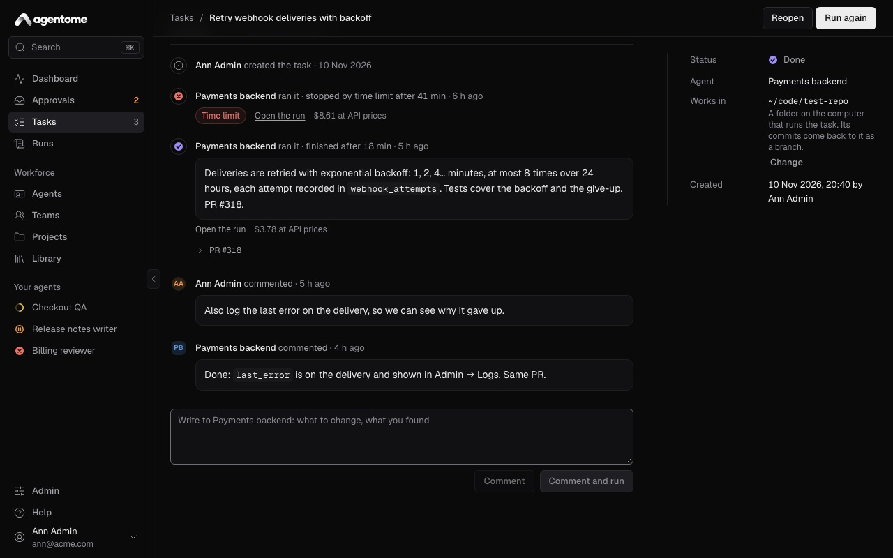

Each run shows its report, a link to **Open the run** or **Follow the run**, and its cost at API
prices. Questions the agent asked you during the run and the change requests it opened are folded
under it. A question that still waits for your answer is shown open.

To write to the agent, use the field at the end:

- **Comment** keeps your comment for the next run.
- **Comment and run** saves it and starts a run at once, which reads it first.

The next run reads the last 20 comments of the thread, people's and agents', up to 2,000 characters
each. It treats the latest comment from a person as what you want from this run. An agent can write
in the thread during a run too, and its owners are notified.

Use the thread to ask for changes: say what to fix and click **Comment and run**, rather than
creating a new task.

### Status and review

A task is **Open**, **In review** or **Done**.

- A new task is **Open**.
- When a run ends **Done**, an open task moves to **In review**: it waits for a person to look at
  the work.
- From **In review**, **Run again** puts it back to **Open**. **Mark as done** closes it.
- When an agent's change request for the task is merged on the code host, the task becomes **Done**
  by itself.

On the change request cards under **Changes**, the review state comes from the code host:
**Approved** or **Changes requested**, together with the pipeline (**CI passed**, **CI failed** or
**CI running**) and the state (**Draft**, **Merged** or **Closed**). Agentome learns the review from
the code host's webhooks, and asks the code host for the pipeline and the state when the page opens.

### Tasks from Jira

A project with a Jira connection turns the issues under its filter into tasks. The server polls
Jira; nothing needs to be set up on the Jira side.

- A new issue becomes a task titled with the issue key and summary, for example **PAY-142: Refunds
  fail for split payments**. Its description starts with the link to the issue.
- The task goes to the connection's agent, if it has one, or else to the lead of the project's team.
  With neither, the project takes no issues.
- It works in the project's main repository.
- When the project's lead takes tasks at once, the lead starts on a new issue right away. Otherwise
  the task waits for someone to run it.
- When the issue changes in Jira, the task's title and description follow.

The work goes back to the issue: a run starts and the issue moves to in progress; a change request
opens and is linked, and the issue moves to in review; the change request merges and the issue moves
to done; a run ends and its summary is posted as a comment with a link to the run.

The task's activity says it was created **from Jira**. Setting up the connection is in
[Integrations](integrations.md).

### Scheduled tasks

An agent can have recurring tasks, such as "every weekday at 09:00". Set them in the **Schedules**
section of the agent's page with **New schedule**: the **Project**, the **Task** title, **What to
do**, the days, the **Time** and the **Time zone**. See [Agents](agents.md).

At that minute a task is made in the project and run, as if a person had filed it. On a person's
computer, the run waits until the agent's owner is at the computer. A minute missed while the server
was down is skipped, not caught up.

## Runs

A run is one attempt at a task by its agent. **Runs** in the sidebar lists them, filtered by
**Live**, **Done**, **Failed** and **All**, with the agent, the computer, when it started, how long
it took and what it cost.

### Run statuses

- **Queued**: waiting for a computer, or a server seat, to pick it up.
- **Running**: the agent is at work.
- **Waiting approval**: the agent made a call that your policy marks "ask", and the run waits for a
  person. On a task this reads **Waiting for you**. See
  [Approvals and control](approvals-and-control.md).
- **Done**: the run finished.
- **Failed**: the run stopped, for example by its time, turn or token limit, or because the computer
  stopped responding. The page says why and what to do.
- **Cancelled**: someone cancelled it.

### Follow a live run

The run page follows the run as it happens.

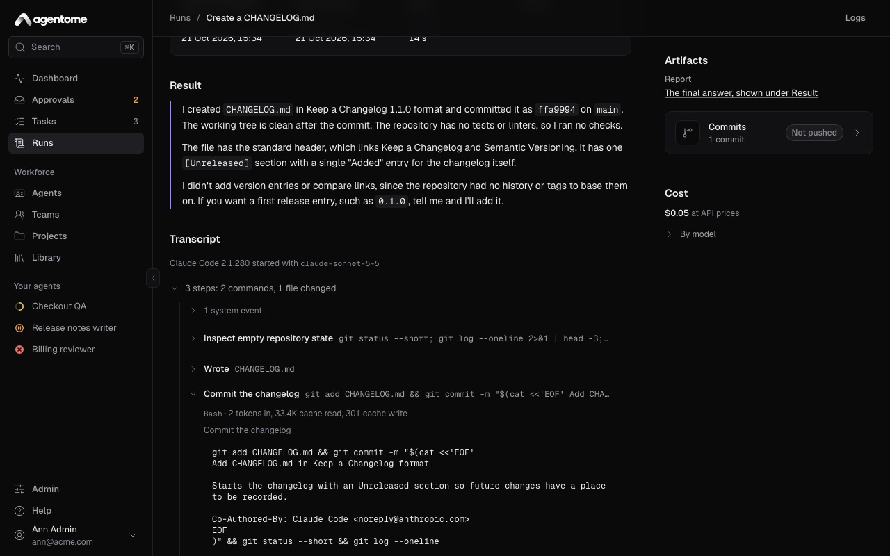

At the top, a panel shows the status and the facts: **Agent**, **Task** (with a link, **Open the
task**), **Ran by** (whose computer), **Started by**, **Started** or **Queued**, **Ended** and
**Duration**.

Under it:

- A call that waits for approval shows first, so you can decide it right there.
- **Plan** is the agent's own to-do list. Each step shows what the agent did while it was the
  current one, and while the run goes, what it is doing now.
- **Transcript** is everything the agent said and did: its messages and its tool calls, grouped into
  rows such as "6 steps: 3 commands, 2 files read" that open to each call. When the run has a plan,
  the transcript is folded; click **Transcript** to open it. A call that asked for approval shows
  who decided and why.

While the run is live, the page keeps the newest event in view. Scroll up to read; click **Jump to
latest** to follow again. If the connection drops, the page says **Reconnecting…** and picks up
where it was.

For a team's run, a **Team** section shows who took part and when. See
[Teams](teams.md#the-team-run-on-the-run-page).

### When a run ends

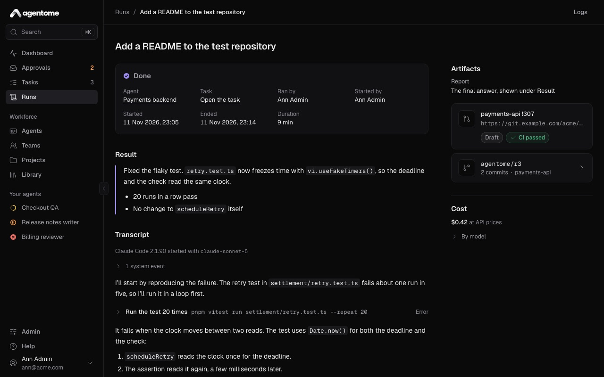

- **Result** at the top is the agent's final answer. A long one shows its start; click **Show the
  whole answer** for the rest.
- **Artifacts**, on the right, holds the **Report**, the **Merge or pull request** and the
  **Branch**.
- **Cost** shows what the run cost at API prices, with **By model** for the tokens of each model. On
  a subscription this is what the run would have cost with an API key.

The report also appears in the task's thread, and the agent's memory carries what it chose to
remember to its next run.

An admin also sees **Logs** at the top, with what the server and the computer logged for this run.

### Branches and change requests

How the agent's work comes back depends on where the task works:

- **A repository on a code host.** The agent commits on a branch under `agent/`, pushes it through
  the server's git proxy and opens a change request. Pushes to other branches are refused. Commits
  it leaves unpushed are kept on `agent/run-<id>` when the run ends **Done**.
- **A folder on the computer.** The commits come back to the folder as the branch
  `agentome/<run id>` when the run ends **Done**.

The **Branch** card lists the commits, says whether they were **Pushed** or **Not pushed**, and
links to **Compare on the code host** when there is one. The change request card shows its state and
its pipeline as the code host gives them, and its review as the code host's webhooks last reported
it.

### Cancel a run

Only the agent's owner can cancel a run.

1. On the run page, click **Cancel run**.
2. Confirm with **Cancel run**.

A queued run leaves the queue and never starts. A running one stops on the computer within about 30
seconds; what it did so far stays in the transcript.
