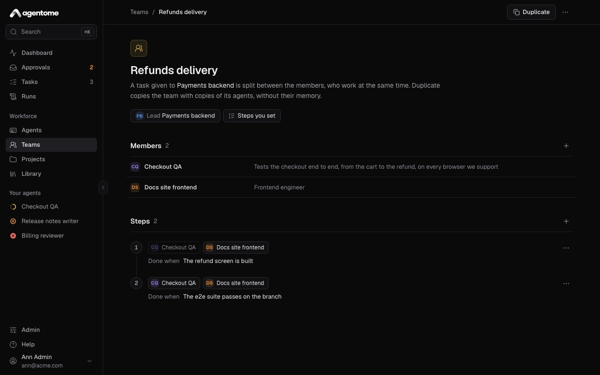
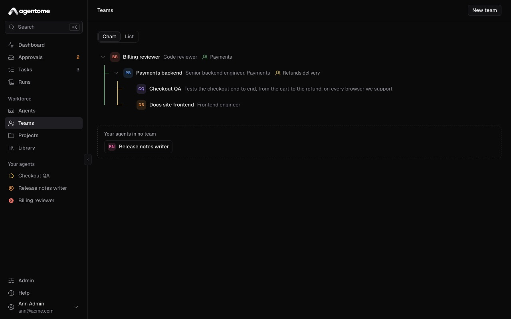
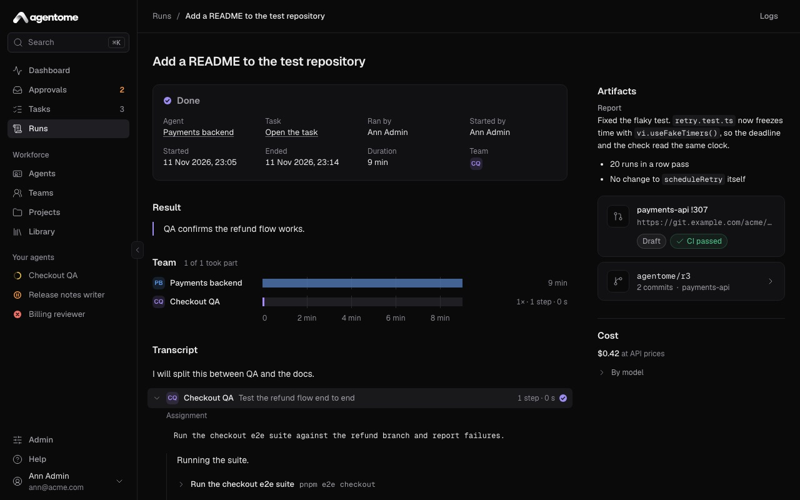

# Teams

A team is a lead agent with members. You give the team a task; the lead splits it, hands the parts
to its members, and they work at the same time.

- [How a team works](#how-a-team-works)
- [Create a team](#create-a-team)
- [Members](#members)
- [Who sets the order](#who-sets-the-order)
- [Waiting for you at a step](#waiting-for-you-at-a-step)
- [Nested teams](#nested-teams)
- [The Teams page](#the-teams-page)
- [A project's team](#a-projects-team)
- [The team run on the run page](#the-team-run-on-the-run-page)
- [Change, duplicate or delete a team](#change-duplicate-or-delete-a-team)

Free includes one team. Needs a license key for more than one, and so for nested teams.

## How a team works

A team's work happens in its lead's run, on the computer of the lead's owner.

1. A task goes to the team: you pick the team as who the task is for in **New task**, or the task is
   filed in a project whose team takes its tasks.
2. The lead reads the task and decides how to split it.
3. The lead gives each member an assignment: the goal, what to hand back, and the limits. Members do
   not see the lead's conversation, so each assignment stands on its own.
4. Members given work in the same step work at the same time. Each works with its own instructions,
   tools, skills and memory, and its tool calls act as that member.
5. Each member finishes with a report. The lead reads the reports, gives more work if needed, and
   ends the run with the result.

Members share the run's workspace and its branch. They commit their work there, and the lead pushes
and opens the change request unless an assignment says otherwise. A lead splits the work by files
when members share the branch.

## Create a team

1. Open **Teams** in the sidebar and click **New team**.
2. Enter a **Name**.
3. Under **Lead**, pick one of your active agents. Its runs are where the team works.
4. Click **Create team**. The team's page opens.
5. Next to **Members**, click **Add an agent** and pick the agents for the lead to lead.

You can also start from an agent's page: in its **Team** section, click **Create a team it leads**.
That section also lists the team the agent leads and the teams it is in.

An agent leads one team at most.

## Members

A team's members are its lead owner's own active agents, since they run on that owner's computer. A
team has up to 10 members. An agent cannot be in its own team.

To take a member out, open its menu in **Members** and choose **Remove from team**. The agent stays,
with its memory, tasks and runs.

An archived member stays out of the team's runs; the other members go on without it.

## Who sets the order

Once a team has members, a chip on its page says who sets the order. Click it to choose under **Who
sets the order**:

- **The lead decides**: the lead decides who works on what, and when.
- **Steps you set**: you set the steps, and the lead follows them.

On the **List** view of **Teams**, the **Order** column shows **The lead decides** or **Steps**.

### Steps

With **Steps you set**, the page shows **Steps**, numbered in order.

- Each step has one or more agents. Click a member's name in a step to add it to the step or take it
  out. A step needs at least one agent.
- **Done when** says what done looks like for the step. Click **Say what done looks like** to write
  it; the lead reads it with the step.
- **Add a step** adds one at the end. To take a step out, open **Actions for step** and choose
  **Remove step**.

A step opens once every agent of the step before it has reported. The agents of one step work at the
same time. The lead may send work back to an agent of an earlier step.

A team with steps keeps at least one. When you switch from **The lead decides** to **Steps you
set**, each member gets a step of its own, in the team's order. A member you add later gets a new
step at the end. A team has up to 10 steps.

## Waiting for you at a step

You can have a team wait for you before it moves on. This is the lead's **Start a team step**
policy, under the **Team** connector in the lead's tools. It is **ask** unless you change it. See
[Agents](agents.md) and [Approvals and control](approvals-and-control.md).

When the policy is **ask**:

- With **The lead decides**, after the lead's first assignments have reported, the work after them
  waits for your approval, once per task. Before it asks, the lead writes in its reply what the
  members found and what comes next, so that you can decide.
- With **Steps you set**, each step waits for your approval before it starts.

The chip's menu says which applies: for example **Each one waits for your approval** or **They start
without your approval**.

The waiting step shows in **Approvals** and on the run page, like any other call that asks.

## Nested teams

Needs a license key.

A team can have, among its members, an agent that leads a team of its own. That agent is not a
member the lead calls inside its run. It is a lead under it, and it takes work down as a whole task.

1. The lead sees the agents under it that lead teams, and hands each one a task with the
   `assign_task` tool: a title and a description that stands on its own.
2. Each assigned task is a new task in the same project and the same repository, given to that lead.
   It gets its own run, with its own team. Its run shows **Another agent** under **Started by**.
3. The lead does not wait. It says in its reply what went to whom and ends its run.
4. When every task it assigned has ended, Agentome runs the lead again on its task, with their
   reports.

On the task page:

- The lead's task shows **Assigned**: each task it handed down, its agent and its status. The lead
  runs again with their reports once every one has ended.
- An assigned task says which lead assigned it and as part of which task. When it ends, its summary
  goes back to that lead.

Limits:

- A task can be split three levels deep: the first task, a task assigned from it, and one assigned
  from that. Deeper, the lead does the work in its own run or with its team.
- One task can have up to 10 assigned tasks.
- A lead assigns only to the leads directly under it in its own team.
- All of them are the same owner's agents: a team's members are always its lead owner's.
- Agentome refuses a change that would put a lead under itself.

If the monthly budget is spent, an assigned task is made but does not start, and the lead is told.

## The Teams page

**Teams** shows your teams two ways: **Chart** and **List**.

### Chart

The chart reads from the top lead down: a lead over its members, and a member that leads a team over
that team, each team's branch in its own colour.

You arrange your own agents on it. Other people's agents are shown, not changed.

- **Drag** one of your agents onto another: the first goes into the second's team. An agent that
  leads no team yet gets one, named after it, with **The lead decides** as its order.
- Click the add button beside an agent to **Put an agent under** it.
- Open an agent's menu for **Move under…**, **Open** its team, or **Remove from** its team.

**Your agents in no team** lists the rest. Drag an agent there to take it out of its team.

### List

The list has a row per team: **Team**, **Lead**, **Members** and **Order**. A team under another is
indented under it. Click a row to open the team.

## A project's team

A project can have a team that takes its tasks. On the project's page, pick the team from the team
chip, and choose who starts a new task: **A person starts it** or **The lead takes it**. Issues from
Jira go to the same lead, unless the Jira connection has an agent of its own.

When you give a project a team, its lead and every agent under it join the project, so their runs
reach its repositories, connections and knowledge. See
[Projects and tasks](projects-and-tasks.md#the-projects-team-and-who-starts-a-task).

## The team run on the run page

A team's run is the lead's run. **Runs** lists the lead alone; the run page shows the team.

- In the facts at the top, **Team** shows the members that took part.
- The **Team** section shows how many members took part, for example **1 of 2 took part**, and a
  lane for the lead and each member on the run's timeline. A bar marks each stretch a member worked;
  hover over it to see the assignment and how long it took. Next to each lane are its number of
  assignments, steps and minutes.
- Members the lead did not call are listed under **Not called yet** while the run goes, and **Not
  called in this run** after.
- **Plan** counts what members did in each step of the lead's plan, and their calls are in the
  transcript.

A task a lead assigned to a team below has a run of its own, on that task's page.

## Change, duplicate or delete a team

On the team's page:

- Click the name to rename the team.
- Click the **Lead** chip to give the team another lead: another active agent of the same owner that
  is not a member.
- **Duplicate** copies the team, named after it with "(copy)", together with copies of its lead and
  its active members, owned by you. The copies have the agents' setup, not their memory, tasks or
  runs. The copy counts as a new team, so it needs a license key.
- **More actions**, then **Delete team…** and **Delete team** removes the team. The lead works alone
  again; the agents stay, with their memory, tasks and runs.
